  

# Meridian Investigation

**Hunt 25: Meridian Patient Portal Intrusion** — scored threat hunt, **99/100, 1st place**.

## Key findings

- **The "exfil" was not C2.** All 73 "blocked exfil" events were the attacker's own SSH session: the IP and port match across three tables, and the gaps between blocks follow TCP retransmission backoff, not a beacon timer.
- **The defence stack blinded itself.** Its bootstrap sweep removed Sysmon 39 minutes before the attack began, so the whole intrusion ran without process-tree logging.
- **An uncorroborated export, flagged rather than assumed.** The defence stack recorded a patient data export that no web or database log supports. The report names the discrepancy and treats it as a possible breach until ruled out.
- **12 detection rules.** All written in KQL, with D6 run and validated against the hunt data.

A hypothesis-driven threat hunt on a single Ubuntu 22.04 host (Apache, PHP, MySQL) running a patient portal, investigated in Microsoft Sentinel with KQL across eight custom log tables. An attacker used a local file inclusion (LFI) flaw in the web application to read a credentials file, logged in over SSH with a stolen service-account password, and escalated to root through a SUID copy of bash, leaving a second SUID-root backdoor disguised as a health check. The hunt separates the real intrusion from the noise of an automated defense stack running on the same host, shows that the stack's 73 "blocked exfil" events were the attacker's own SSH session rather than a C2 channel, and delivers 12 detection rules, 8 telemetry gaps and an IR handover.

## Attack chain

All times UTC, 2026-02-06.

1. **Reconnaissance (03:47–03:55)** — Nmap, curl, WhatWeb and gobuster (18,454 requests in 4 seconds) against the portal. `config_viewer.php` was requested by name before any wordlist scan. (T1595, T1595.003)
2. **Portal login (03:54)** — authenticated session on `/dashboard.php`. The source of the portal credential is not established.
3. **LFI (04:07–04:08)** — `config_viewer.php?file=../../../etc/passwd`, then `?file=database.conf`. The `file` parameter has no allowlist. (T1190)
4. **Credential theft to SSH (04:09)** — password login as `svc_backup` 57 seconds after `database.conf` was read. (T1552.001, T1078.003)
5. **Failed sudo (04:15)** — `svc_backup` has no sudo rights. (T1548.003, attempted)
6. **SUID root (04:40)** — `/tmp/rootbash -p` executed with auid 1001, euid 0. (T1548.001)
7. **Failed root SSH (04:44–04:46)** — six root password attempts, none accepted. (T1110.001, attempted)
8. **Return SSH sessions (04:47, 04:48)** — the defense stack blocked the server's replies to the second session and logged them as 73 "exfil" events.
9. **Second backdoor (by 04:51)** — SUID-root `health_check` running from `/opt/meridian/scripts/`, orphaned to PID 1. (T1036.005)
10. **Config tampering** — `backup.conf` modified, reverted by the 05:05 sweep. (T1565.001)
11. **Partial remediation (05:05)** — the sweep killed `rootbash` and flagged `health_check` but did not stop it. Containment was not achieved at the end of the window.

One element stays open: the defense stack recorded a patient data export at 03:56:28 that no web or database log corroborates (T1213, uncorroborated).

## Detection rules

| ID | Rule | ATT&CK |
|----|------|--------|
| D1 | Reconnaissance tool user-agents | T1595, T1595.003 |
| D2 | Path traversal or sensitive-file read through a file parameter | T1190 |
| D3 | SSH login to a service account from a non-baseline IP | T1078.003 |
| D4 | Effective-root execution by a non-root user outside the SUID allowlist | T1548.001 |
| D5 | Non-baseline file in the application scripts directory | T1036.005 |
| D6 | Defender "exfil" blocks that match an accepted SSH session | Classification check (supports T1078.003 triage) |
| D7 | Defence stack removal of a telemetry service | Defender misconfiguration (related: T1562.001) |
| D8 | Patient data export from an address outside the host subnet | T1213 |
| D9 | Configuration tampering reverted by the sweep | T1565.001 |
| D10 | Two root-access methods failing on one host within an hour | T1548.003, T1110.001 |
| D11 | Memory acquisition tool execution | IR awareness alert |
| D12 | One-second SSH session from a non-baseline IP | T1078.003 (candidate T1105) |

All 12 are written in KQL in section 14 of the report, each with logic, false-positive assessment and expected results. D6 was run and validated against the hunt data; the others are proposed.

## Tools and methods

- **Microsoft Sentinel / Log Analytics** — investigation platform
- **KQL** — all hunt queries (29 in Appendix A) and detection rules
- **Custom log tables** — `MeridianAccess_CL`, `MeridianAuth_CL`, `MeridianAudit_CL`, `MeridianDefender_CL`, `MeridianSyslog_CL`, `MeridianSnapshot_CL`, `MeridianNetwork_CL`, `MeridianMySQL_CL`
- **MITRE ATT&CK** — technique mapping for findings and detections
- **PEAK** and **TaHiTI** — threat hunting methodology
- **ABLE** — hypothesis scoping (Actor, Behaviour, Location, Evidence)

## What's in the report

**Full report (PDF):** [Hunt_25_Meridian_Threat_Hunt_Report_v1.5.pdf](Hunt_25_Meridian_Threat_Hunt_Report_v1.5.pdf) (49 pages, TLP:CLEAR)

**Editable version:** [Hunt_25_Meridian_Threat_Hunt_Report_v1.5.docx](Hunt_25_Meridian_Threat_Hunt_Report_v1.5.docx)

Executive summary, hypothesis and scope, 14 investigation pivots with queries and screenshots, a dead-ends table, UTC timeline, 12 findings with confidence levels, negative findings, ATT&CK coverage, 8 telemetry gaps, 12 detection rules, IR handover, next-hunt leads, and the full query appendix.
