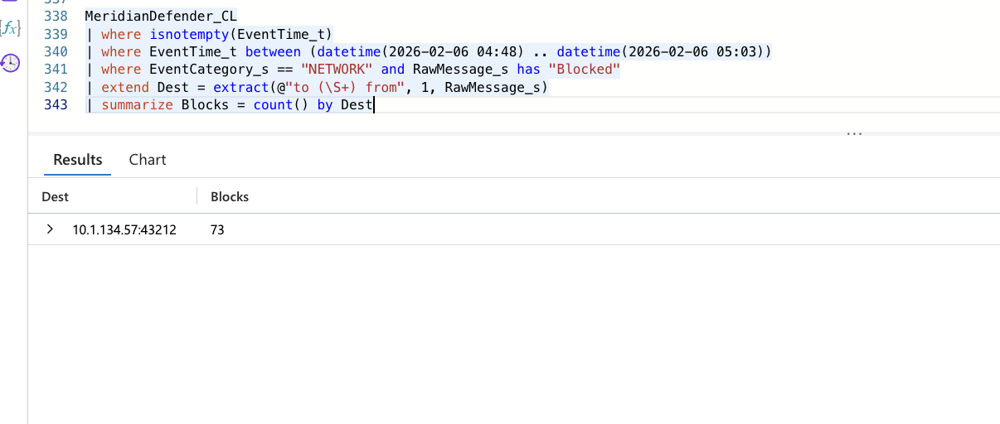

**Jenna Frank (Hot Pink Huntress)**, Security Operations Manager · [Portfolio](https://www.JennaFrank.co) · [Repository](https://github.com/jennafrank/meridian-investigation)

On 2026-02-06 an attacker broke into a healthcare patient portal running on a single Ubuntu server, and left a root backdoor running there. An automated defence stack was running on the same host and producing its own noise. I hunted the intrusion in Microsoft Sentinel with KQL across eight custom log tables, separated the attacker's activity from the defence stack's, and wrote 12 detection rules and an IR handover. Scored 99/100, first place.

## The problem

The portal's defence stack raised 73 "blocked exfil" alerts and recorded a patient data export. The questions were:

- What actually happened on the host?
- Was data stolen?
- Is the attacker still in?

## What I did

- **Hypothesis-driven hunt:** I stated the hypothesis and two counter-hypotheses up front, then tested each one against the telemetry.
- **Rebuilt the kill chain:** it runs from reconnaissance (Nmap, curl, WhatWeb, gobuster) through a local file inclusion flaw, a stolen service-account password, SSH and a SUID root shell, to a second SUID backdoor disguised as `health_check`.
- **Corroboration stated:** each finding records whether a second log source confirms it, or says so when only one does (F8). Every query is in the report.

## Key findings

- **The "exfil" was not C2.** All 73 blocks went to the attacker's own SSH client port (`10.1.134.57:43212`), from the server's port 22, within the same second as the login. The gaps between blocks follow TCP retransmission backoff, not a beacon timer.
- **The defence stack blinded itself.** Its startup sweep removed Sysmon 39 minutes before the attack began.
- **The export is flagged, not assumed.** A patient data export was recorded, but no web or database log corroborates it. The report treats it as a possible breach until it is ruled out.
- **Not contained.** The `health_check` backdoor was still running as root at the end of the window.

*Figure 7.8f from the report: all 73 blocks share one destination, the attacker's SSH session.*

## Read more

- [Full threat hunt report](report.md): findings F1 to F12, ATT&CK coverage, telemetry gaps, detections D1 to D12 and all queries
- [PDF original](https://github.com/jennafrank/meridian-investigation/blob/main/Hunt_25_Meridian_Threat_Hunt_Report_v1.5.pdf)
- [Repository](https://github.com/jennafrank/meridian-investigation)

[Back to my portfolio](https://www.JennaFrank.co)
