> Markdown edition of *Hunt_25_Meridian_Threat_Hunt_Report_v1.5.docx* (TLP:CLEAR), converted for this site. The content is unchanged from version 1.5; only the layout is adapted for the web. The [PDF](https://github.com/jennafrank/meridian-investigation/blob/main/Hunt_25_Meridian_Threat_Hunt_Report_v1.5.pdf) is the formatted original. [Back to the project page](index.md).

# Hunt 25 Meridian: Threat Hunt Report

## 01 Front Matter and Document Control

| **Field**         | **Value**                                    |
|-------------------|----------------------------------------------|
| Report title      | Hunt 25: Meridian Patient Portal Intrusion   |
| Hunt ID           | HUNT-25-MERIDIAN                             |
| Author            | Jenna Frank                                  |
| Version           | 1.5                                          |
| Date issued (UTC) | 2026-10-03                                   |
| Classification    | TLP:CLEAR                                    |
| Distribution      | PacificWatch SOC, Log(N) Pacific Cyber Range |

**Revision history**

| **Version** | **Date (UTC)** | **Author**  | **Change**                                                                                                                                                                                                                                                                                                                                                                                                                                                                                                                                                                                             |
|-------------|----------------|-------------|--------------------------------------------------------------------------------------------------------------------------------------------------------------------------------------------------------------------------------------------------------------------------------------------------------------------------------------------------------------------------------------------------------------------------------------------------------------------------------------------------------------------------------------------------------------------------------------------------------|
| 0.9         | 2026-10-02     | Jenna Frank | Draft with initial kill chain, findings F1 to F12, and detection rules D1 to D11                                                                                                                                                                                                                                                                                                                                                                                                                                                                                                                       |
| 1.0         | 2026-10-02     | Jenna Frank | 73-count correction, export timestamp added, A16 query scoped, timeline updated                                                                                                                                                                                                                                                                                                                                                                                                                                                                                                                        |
| 1.1         | 2026-10-03     | Jenna Frank | Pre-submission QA. Re-tested the C2 attribution (A18, A19): the 73 NETWORK blocks map to the attacker's 04:48:28 SSH session, so F7 was rewritten and the beacon hypothesis rejected. Added the 04:47:44 and 04:48:28 SSH sessions to the timeline. Corrected tool versions and first-seen times against A1, the bootstrap event count (18), the sudo baseline (2 sessions) and the F4 ordering. Tested the export event for a second source (A20, zero rows). Fixed D2, D4, D6 and D10 logic, added D12, remapped ATT&CK, repaired screenshot placement and captions, and removed unbacked negatives. |
| 1.2         | 2026-10-03     | Jenna Frank | Assessed MeridianMySQL_CL (A22, A23): 16 rows, general log ends at 03:20:01, 27 minutes before the first attacker request, so portal login, export and SQL injection are untestable there (new pivot 7.14, gap G7). The 02:58:26 bootstrap DB event gained a second source. Confirmed all 73 NETWORK blocks share one destination (A24). Re-ran the export second-source tests with an explicit TimeGenerated filter (A20, A25): zero rows, and no non-gobuster attacker traffic in the export window.                                                                                                 |
| 1.3         | 2026-10-03     | Jenna Frank | Re-tested the export trigger (A26 to A29). gobuster ran only 03:55:05 to 03:55:08, and the attacker sent no web request between 03:55:33 and 03:56:40, so the 03:56:28 Defender export event has no matching request in any log. F8 changed from confirmed to uncorroborated; corrected the v1.2 statement that gobuster filled the export window; added the manual curl probes at 03:55:15 to 03:55:33 and the second portal login at 04:07:47.                                                                                                                                                       |
| 1.4         | 2026-10-03     | Jenna Frank | Re-read the health_check snapshot in full (A7, Figure 7.7a). ProcBeaconUid_s is the /proc status Uid line (1001 0 0 0), confirming effective UID 0. ProcBeaconExeLink_s is an ls -l of /proc/267155/exe stamped Feb 6 04:51 and pointing to /opt/meridian/scripts/health_check with no "(deleted)" marker. Restored the 04:51 start bound with its source field and withdrew the earlier "(deleted)" reading and the unresolved deletion link built on it.                                                                                                                                             |
| 1.5         | 2026-10-03     | Jenna Frank | Added the TimeGenerated scoping line to every detection query so D1 to D12 follow the workspace scoping rule in section 06. Ran D6 against the hunt data: it returns the single expected row (svc_backup, 10.1.134.57:43212, 73 blocks) and is marked validated (Figure 14.1).                                                                                                                                                                                                                                                                                                                         |

## 02 Executive Summary

Meridian Health runs a patient portal: a website where patients manage appointments and medical records. On 2026-02-06, between 03:47 and 05:05 UTC, an attacker from an outside address broke into this portal and left a hidden program running on the server with full control. The automated defense system caught and undid much of the attack. During its own startup, however, 39 minutes before the attack began, it removed one of the server's main monitoring tools, so the whole intrusion happened with reduced visibility.

The attacker scanned the portal with four tools and signed in to it. How they obtained that portal login is not established. Two minutes later the defense system recorded a patient data export from their address, but no matching request appears in the web logs and the database log had already stopped, so the export cannot be confirmed or ruled out. The attacker then used a file-reading flaw in a configuration page to read a file holding stored passwords, and 57 seconds later used one of those passwords to log in to the server directly. The server refused their request for administrator rights. They gained full control anyway through a hidden copy of the system command shell, then tried twice more to sign in directly as the administrator and were refused both times.

The attacker logged in to the server twice more. The defense system blocked the server's replies to the second of those logins and recorded each block as an attempt to steal data. This hunt shows those blocks were the attacker's own remote session being cut off, not a separate data theft channel. The defense system's scheduled clean-up at 05:05 stopped the hidden shell, reverted a tampered backup setting, and flagged a second hidden program disguised as a routine health check. It did not stop that program, which was still running with full control at the end of the observation window.

The incident is not contained. The disguised program must be stopped and the account the attacker used must be locked before the server can be declared clean. Because the attacker had access to the portal and to the server, and a patient data export was recorded, the incident should be treated as a possible patient data breach for regulatory review until the export is confirmed or ruled out. Every password in the stolen configuration file must be changed, and the file-reading flaw in the portal must be fixed.

## 03 Overview Metadata

| **Field**           | **Value**                                                                                                                                                                            |
|---------------------|--------------------------------------------------------------------------------------------------------------------------------------------------------------------------------------|
| Hunt type           | Hypothesis-driven                                                                                                                                                                    |
| Trigger             | Overnight incident on Meridian patient portal; automated defense stack active alongside real intrusion; need to separate defense noise from attacker activity and assess containment |
| Period hunted (UTC) | 2026-02-06 02:42:00 to 2026-02-06 05:30:00                                                                                                                                           |
| Estate in scope     | Single host: ip-10-1-15-67 (10.1.15.67), Ubuntu 22.04, Apache + PHP + MySQL                                                                                                          |
| Analyst(s)          | Jenna Frank                                                                                                                                                                          |
| Time spent          | Hunt session 2026-09-28; QA re-test sessions 2026-10-03                                                                                                                              |

**Environment topology.** The estate is a single Ubuntu 22.04 host, ip-10-1-15-67 (10.1.15.67), running an Apache/PHP patient portal backed by MySQL, an automated defense stack (detect, sweep, network block), cron-driven backups (/opt/meridian/scripts/backup.sh, every 10 minutes as root), and the AWS Systems Manager agent (failing on a missing IAM role for account 662863940582, see 7.15). Three sources appear in the window. The attacker, 10.1.134.57, reached the host over HTTP and SSH (client ports 39206, 50108, 54886 and 43212). The returning administrator, ubuntu, logged in by SSH key from 10.0.2.139 at 05:22:55. Local traffic from 127.0.0.1 and 10.1.15.67 belongs to the defense stack bootstrap (02:56:33) and to the 04:44 root login attempts, which most likely came from inside the attacker's svc_backup session (Confidence: Medium; it was the only non-admin session open at the time). No other host appears in any table.

## 04 Hypothesis and ABLE Scope

**Hypothesis:** An external attacker exploited a vulnerability in the Meridian patient portal to gain initial access, escalated privileges, exfiltrated patient data, and established persistence, while the automated defense stack both detected and partially remediated the intrusion but also introduced its own detection gaps through misconfigured baseline logic.

**ABLE scope:**

| Dimension | Value                                                                                                                                                                                                                                                                                                                                         |
|-----------|-----------------------------------------------------------------------------------------------------------------------------------------------------------------------------------------------------------------------------------------------------------------------------------------------------------------------------------------------|
| Actor     | External, unattributed. Source IP 10.1.134.57                                                                                                                                                                                                                                                                                                 |
| Behaviour | Web application exploitation (path traversal), credential theft, privilege escalation via SUID binary, data exfiltration, persistence via disguised SUID backdoor, C2 beaconing                                                                                                                                                               |
| Location  | ip-10-1-15-67 (10.1.15.67): Apache web service, SSH, MySQL database, application scripts directory, cron/systemd, network egress                                                                                                                                                                                                              |
| Evidence  | MeridianAccess_CL (web logs), MeridianAuth_CL (authentication), MeridianAudit_CL (process execution with EXECVE), MeridianDefender_CL (defense stack detections, sweeps, network blocks), MeridianSyslog_CL (system logs), MeridianSnapshot_CL (process tree snapshots), MeridianNetwork_CL (network state), MeridianMySQL_CL (database logs) |

**Counter-hypothesis:** The pre-intrusion detection burst (02:53 to 03:08 UTC) represents early attacker activity rather than defense-stack bootstrap noise. This must be tested against the timeline of confirmed attacker activity to determine whether the detections are signal or self-generated noise.

**Counter-hypothesis 2 (raised in QA):** The 73 NETWORK "Blocked exfil" events are the health_check backdoor beaconing to the attacker. The alternative is that they are the server's replies to an attacker SSH session, blocked by the defense stack and labelled as exfil. Tested in 7.8 by matching the blocked destination port against SSH client ports in MeridianAuth_CL. Result: counter-hypothesis 2 is rejected.

## 05 Threat Intel Inputs

| Input                                                                         | Source                                                   | How it shaped the hunt                                                                                                                                                                                                 |
|-------------------------------------------------------------------------------|----------------------------------------------------------|------------------------------------------------------------------------------------------------------------------------------------------------------------------------------------------------------------------------|
| Hunt briefing: overnight incident on patient portal with active defense stack | Log(N) Pacific Cyber Range, Hunt 25 brief                | Established the scenario: a real intrusion alongside an automated defense stack generating its own noise. Framed the primary challenge as separating attacker activity from defense-stack artifacts                    |
| Defense stack behaviour: baseline-revert remediation model                    | Hunt brief, confirmed from MeridianDefender_CL telemetry | Indicated the stack would detect, log, and auto-remediate certain artifact types (SSH keys, crontabs, temp dirs, SUID in watched paths, systemd services). Critical to understanding what the stack can and cannot fix |
| Data dictionary: 8 custom tables with field-name and time-column gotchas      | Hunt brief data dictionary                               | Directed all queries to use EventTime_t (not TimeGenerated) and to filter isnotempty(EventTime_t) to drop failed-ingestion leftovers. Prevented false negatives from wrong time columns or hostname fields             |

Intel limitations: the brief described the scenario but did not attribute the attacker or name specific CVEs. The attacker's toolchain and exploitation method were discovered from telemetry, not from prior intelligence. The brief warned that the defense stack generates noise and that not everything it flags represents the attacker, which proved accurate.

## 06 Scope, Data Sources and Blind Spots

| **Data source**     | **Platform**             | **Period available**          | **Coverage confidence**                                                                                                                                                                                                                                                                                                                                             |
|---------------------|--------------------------|-------------------------------|---------------------------------------------------------------------------------------------------------------------------------------------------------------------------------------------------------------------------------------------------------------------------------------------------------------------------------------------------------------------|
| MeridianAccess_CL   | Microsoft Sentinel (KQL) | Full window (02:42 to 05:30)  | High: web access logs with ClientIp_s, RequestUri_s, UserAgent_s, StatusCode_s, ResponseSize_s. Complete for HTTP-layer analysis. Does not log request bodies or application-level authentication outcomes.                                                                                                                                                         |
| MeridianAuth_CL     | Microsoft Sentinel (KQL) | Full window                   | High: sshd, sudo and PAM records with ProcessName_s, TargetUser_s, SourceIP, RawMessage_s. Captures accepted and failed logins with client ports, which made the 7.8 port match possible.                                                                                                                                                                           |
| MeridianAudit_CL    | Microsoft Sentinel (KQL) | Full window                   | Low: EXECVE records with comm_s, exe_s, Argv_s, auid_s, euid_s. Records rootbash and sshd executions but no cp, chmod or unlink events, and no execution record for health_check. Execution evidence, not creation evidence.                                                                                                                                        |
| MeridianDefender_CL | Microsoft Sentinel (KQL) | Full window                   | Medium: complete for the defense stack's own actions (DETECTION, SWEEP, SSH, AUTH, NETWORK, WEB, DB). Its labels cannot be taken at face value: it labelled SSH return traffic as "exfil" (7.8), labelled a SELECT count(\*) as a "Full patient table query" (7.14), and the DETECTION category was silent from 03:09 to 05:05 while the attacker was active (A19). |
| MeridianSyslog_CL   | Microsoft Sentinel (KQL) | Full window                   | Medium: CRON, amazon-ssm-agent and kernel NETMON_EXFIL lines with ProcessName_s, RawMessage_s. sysmon.service was removed at 03:08:20, so no Sysmon process events exist for the intrusion.                                                                                                                                                                         |
| MeridianSnapshot_CL | Microsoft Sentinel (KQL) | Point-in-time (end of window) | Medium: process snapshot with ProcBeaconName_s, ProcBeaconExeLink_s, ProcBeaconUid_s, ProcBeaconPPid_s. Confirms what was running at observation time; no history and no dedicated start-time field. ProcBeaconExeLink_s carries an ls -l timestamp of the /proc exe link, which bounds process start (7.7).                                                        |
| MeridianNetwork_CL  | Microsoft Sentinel (KQL) | Full window                   | Low: listening-socket state only (State_s = LISTEN, wildcard PeerAddress_s). No outbound connection records and no RawMessage_s column.                                                                                                                                                                                                                             |
| MeridianMySQL_CL    | Microsoft Sentinel (KQL) | 02:53:30 to 03:20:01 only     | None for the intrusion: 16 general.log rows, all ingested in one batch (A22, A23). The log ends 27 minutes before the first attacker request, so it cannot show the portal login, the export or SQL injection (7.14, gap G7). Useful only as a second source for bootstrap activity.                                                                                |

**Blind spots:**

1.  **Process-level visibility after 03:08:20 UTC.** The defense stack's bootstrap sweep removed sysmon.service at 2026-02-06 03:08:20 UTC, treating it as a non-baseline service. Sysmon was therefore absent for the whole intrusion (first attacker request 03:47:32). The hunt relied on MeridianAudit_CL EXECVE records and the end-of-window MeridianSnapshot_CL instead.

2.  **SUID binary staging.** MeridianAudit_CL records the execution of /tmp/rootbash but no cp or chmod for it, and records nothing at all for /opt/meridian/scripts/health_check. How either binary was created is not established from available telemetry.

3.  **Contents of database.conf.** The LFI read is confirmed (MeridianAccess_CL, 2026-02-06 04:08:34, 1,231 bytes) but the file contents are not captured anywhere. The link from that read to the svc_backup SSH login 57 seconds later is an inference (Confidence: High).

4.  **Portal authentication.** No table records application login outcomes or credentials, and the MySQL general log ends at 03:20:01 (7.14). The attacker reached /dashboard.php with HTTP 200 at 03:54:09, 14 minutes before the credential file was read, so the source of the portal login is not established.

5.  **Patient data export.** MeridianDefender_CL logs "Patient data export from 10.1.134.57" at 03:56:28 but no query, record count or volume. MeridianAccess_CL has no request from 10.1.134.57 between 03:55:33 and 03:56:40 (A27, A29), and MeridianMySQL_CL has no rows after 03:20:01 (A23). No second source exists, so whether the export happened is not established.

6.  **Defense stack labels and silence.** The NETWORK category labels blocked SSH return traffic as "exfil" (7.8), and the DETECTION category produced no events between 03:09 and 05:05 (A19). Defender output was used as evidence of defender actions, not as ground truth about attacker intent.

7.  **Outbound connection telemetry.** MeridianNetwork_CL holds only listening sockets. Outbound activity is visible only where the defense stack blocked it (Defender NETWORK, kernel NETMON_EXFIL). Any health_check network activity that was not blocked would be invisible, so its purpose is not established.

8.  **SQL injection.** The hunt brief references SQL injection. No SQLi is asserted in this report, and none can be tested: the MySQL general log ends at 03:20:01, before any attacker activity (7.14). The only Defender DB event (02:58:26) is bootstrap noise with a matching MySQL record (F11).

**Workspace scoping.** All queries filter on EventTime_t and apply isnotempty(EventTime_t) to drop leftover rows from earlier failed ingestions in the shared LAW-HuntPractice workspace. Log Analytics applies the portal time picker to any query without a TimeGenerated filter, which can return a false zero for this February 2026 data ingested in August 2026. Every zero-row result in this report (A20, A25, and the MySQL coverage checks A22 and A23) was run with an explicit TimeGenerated \> ago(365d) filter. Screenshots display UTC unless a caption says otherwise.

## 07 Execution

Each pivot shows the query as run. Full query text, scoped to the hunt window, is in Appendix A. All queries apply isnotempty(EventTime_t).

### 7.1 Pivot: Attacker reconnaissance toolchain

**Question:** How many distinct recon tools hit the web server, and in what order?

```kql
MeridianAccess_CL
| where EventTime_t between (datetime(2026-02-06) .. datetime(2026-02-07))
| where isnotempty(EventTime_t)
| where ClientIp_s == "10.1.134.57"
| summarize FirstSeen=min(EventTime_t), RequestCount=count() by UserAgent_s
| sort by FirstSeen asc
```

**Returned:** Five user-agent strings from 10.1.134.57: Mozilla/5.0 (compatible; Nmap Scripting Engine) first seen 03:47:32 (29 requests); "-" first seen 03:47:32 (4 requests); curl/8.18.0 first seen 03:52:09 (16); WhatWeb/0.6.3 first seen 03:54:54 (1); gobuster/3.8.2 first seen 03:55:05 (18,454).

**Read:** Four tools in order: Nmap, curl, WhatWeb, gobuster. The four empty user-agent requests share Nmap's first-seen second. Nmap service-version probes send bare HTTP requests without a user-agent, so these are most likely Nmap rather than a fifth tool (Confidence: Medium). The earliest attacker request in the web logs is 2026-02-06 03:47:32 UTC, and that is the start of attacker activity used throughout this report.

**Baseline count:** 18,454 of 18,504 attacker requests came from gobuster, all in 4 seconds, 03:55:05 to 03:55:08 (A28, Figure 7.1b). The remaining 50 were Nmap (29 + 4 empty user-agent), curl (16) and WhatWeb (1). The only other client in 03:55 to 04:08 is ::1, "Apache/2.4.52 (Ubuntu) (internal dummy connection)", 3 requests at 03:55:09 to 03:55:11: Apache's own worker management right after the scan burst, not a client. Discriminator: ClientIp_s (::1 versus 10.1.134.57).

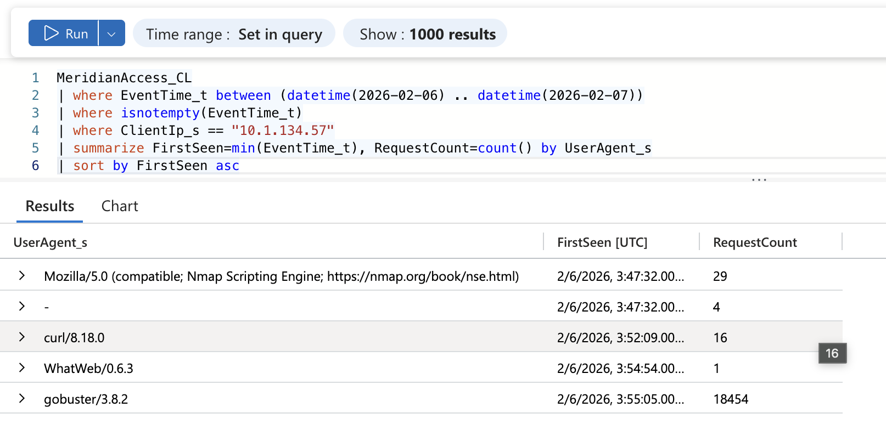

*Figure 7.1a: A1 output. User-agent breakdown for 10.1.134.57 with first-seen time and request count per tool.*

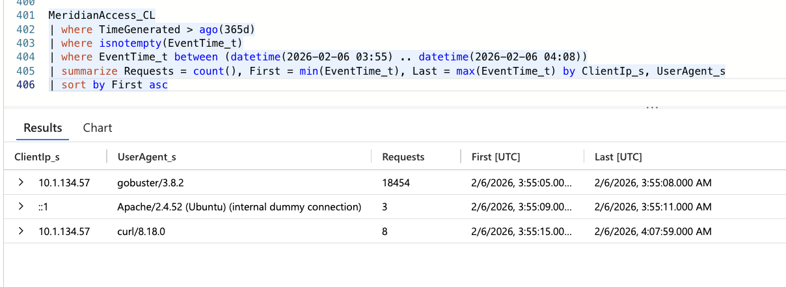

*Figure 7.1b: A28 output. Every client from 03:55 to 04:08: gobuster for 4 seconds, three Apache internal dummy connections, then eight curl requests to 04:07:59.*

### 7.2 Pivot: Pre-scan deliberate endpoint touch and portal login

**Question:** Before the gobuster scan at 03:55:05, did the attacker deliberately touch a specific endpoint, and did they authenticate to the portal?

```kql
MeridianAccess_CL
| where EventTime_t between (datetime(2026-02-06) .. datetime(2026-02-07))
| where isnotempty(EventTime_t)
| where ClientIp_s == "10.1.134.57"
| where EventTime_t < datetime(2026-02-06 03:55:00)
| where UserAgent_s == "curl/8.18.0"
| project EventTime_t, HttpMethod_s, RequestUri_s, StatusCode_s
| sort by EventTime_t asc
```

**Returned:** Seven curl requests: GET / (200) at 03:52:09; GET /robots.txt (200) at 03:52:21; GET /config_viewer.php (302) at 03:52:29; POST /index.php (200) at 03:53:36 and 03:54:04; GET /dashboard.php (200) at 03:54:09; POST /index.php (302) at 03:54:09.

**Read:** config_viewer.php was requested by name before any wordlist scan, and gobuster never requested it at all (7.3 returns only three config_viewer rows, none from gobuster). The request was deliberate (Confidence: High). Where the attacker learned the name is open: it came 8 seconds after a successful GET /robots.txt, and the response body is not logged, so robots.txt is as plausible a source as prior knowledge (Confidence that the attacker knew the endpoint before the session: Low). The 302 on config_viewer.php shows it requires a session. Two POSTs to /index.php followed by GET /dashboard.php returning 200 show the attacker held an authenticated portal session by 03:54:09 (Confidence: Medium). This is 14 minutes before database.conf was read, so the portal credential did not come from that file. Its source is not established (Blind Spot 4). After gobuster the attacker probed by hand with curl: /index.php.bak (404) at 03:55:15, /.htaccess (403) at 03:55:22, /admin/ (404) at 03:55:28 and /backups/ (404) at 03:55:33, then GET / (200) at 03:56:40 and nothing more for 11 minutes. At 04:07:47 they logged in to the portal again (POST /index.php 302, GET /dashboard.php 200) and read /etc/passwd 12 seconds later (A29, Figure 7.9b). The same unknown portal credential was used twice.

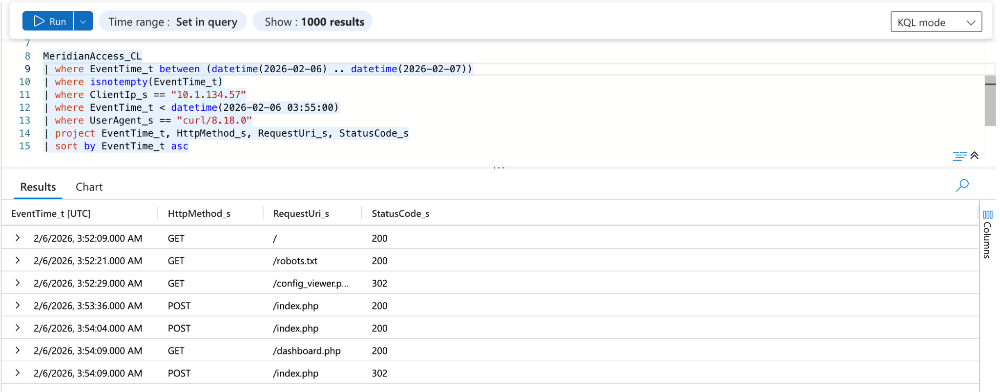

*Figure 7.2: A2 output. curl requests before the gobuster scan, including /robots.txt at 03:52:21 and config_viewer.php at 03:52:29.*

### 7.3 Pivot: LFI exploitation through config_viewer.php

**Question:** Once authenticated, what files did the attacker pull through the file parameter?

```kql
MeridianAccess_CL
| where EventTime_t between (datetime(2026-02-06) .. datetime(2026-02-07))
| where isnotempty(EventTime_t)
| where ClientIp_s == "10.1.134.57"
| where RequestUri_s contains "config_viewer"
| project EventTime_t, HttpMethod_s, RequestUri_s, StatusCode_s
| sort by EventTime_t asc
```

**Returned:** Three rows. GET /config_viewer.php (302) at 03:52:29; GET /config_viewer.php?file=../../../etc/passwd (200) at 04:07:59; GET /config_viewer.php?file=database.conf (200) at 04:08:34. A3 adds ResponseSize_s: 3,077 bytes and 1,231 bytes for the two successful reads.

**Read:** Two successful local file inclusion reads. The first uses path traversal to escape the web root. The second needs no traversal: the file parameter accepts a bare filename in the application's own directory. The parameter is not restricted to an allowlist. Users were enumerated first, then connection credentials. The 35-second gap fits a person working step by step rather than a scanner (Confidence: Medium).

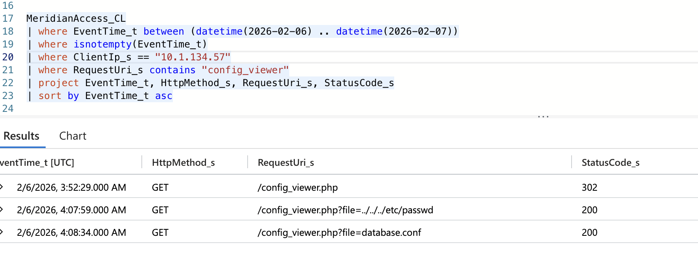

*Figure 7.3: config_viewer.php requests from 10.1.134.57. The unauthenticated 302, then the /etc/passwd traversal and the database.conf read.*

### 7.4 Pivot: SSH login using stolen credentials

**Question:** Did the attacker use credentials from database.conf to log in via SSH?

```kql
MeridianAuth_CL
| where EventTime_t between (datetime(2026-02-06 04:08) .. datetime(2026-02-06 04:15))
| where isnotempty(EventTime_t)
| where ProcessName_s == "sshd"
| where RawMessage_s has "Accepted"
| project EventTime_t, TargetUser_s, SourceIP, RawMessage_s
| sort by EventTime_t asc
```

**Returned:** One record at 2026-02-06 04:09:31: TargetUser_s = svc_backup, SourceIP = 10.1.134.57, "Accepted password for svc_backup from 10.1.134.57 port 39206 ssh2".

**Read:** The attacker logged in as svc_backup with a password 57 seconds after reading database.conf. A5 returns no failed svc_backup password attempts between 04:00 and 05:00, so the password was not guessed. The credential came from database.conf (Confidence: High; inference from the timing and the absence of guessing).

**Two-source corroboration:** MeridianDefender_CL SSH records "Login 'svc_backup' from 10.1.134.57" at the same second, 04:09:31 (A19, Figure 7.4b). The two tables agree on account, source and time.

**Baseline separation:** In-window svc_backup SSH logins number four: one from 127.0.0.1 at 02:56:33 during defense-stack bootstrap (A12), and three from 10.1.134.57 at 04:09:31 (A4), 04:47:44 and 04:48:28 (A18). The only other interactive SSH login is the administrator, ubuntu, by key from 10.0.2.139 at 05:22:55 (Figure 7.8d). The discriminator is SourceIP: 10.1.134.57 appears only on attacker activity. Separately, sudo shows two legitimate administrator sessions (opened 02:43:19 and closed 03:21:19; opened 05:23:01) and one denial for svc_backup (A15, Figure 7.5a).

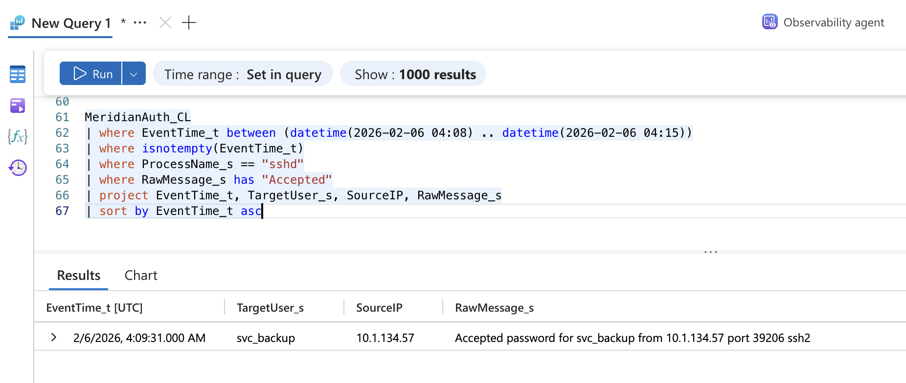

*Figure 7.4a: A4 output. The 04:09:31 svc_backup password login from 10.1.134.57, port 39206.*

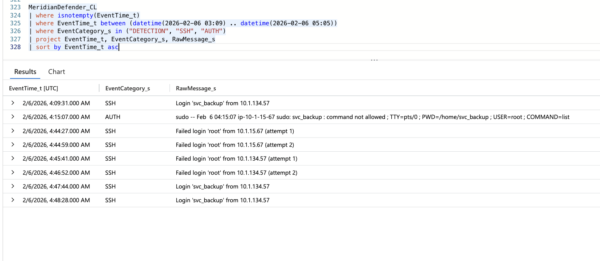

*Figure 7.4b: A19 output. Defender SSH and AUTH events from 03:09 to 05:05: svc_backup logins at 04:09:31, 04:47:44 and 04:48:28, the sudo denial, four failed root login attempts, and no DETECTION events.*

### 7.5 Pivot: Failed root-access attempts before and after the SUID shell

**Question:** What other root-access methods did the attacker try, and when relative to the SUID shell at 04:40:15?

```kql
MeridianAuth_CL
| where EventTime_t between (datetime(2026-02-06 04:00) .. datetime(2026-02-06 05:00))
| where isnotempty(EventTime_t)
| where RawMessage_s has_any ("failed", "FAILED", "incorrect", "not allowed", "denied")
| project EventTime_t, ProcessName_s, TargetUser_s, RawMessage_s
| sort by EventTime_t asc
```

**Returned:** Two methods, both failed:

1.  **sudo, before the SUID shell.** 2026-02-06 04:15:07: "svc_backup : command not allowed ; TTY=pts/0 ; PWD=/home/svc_backup ; USER=root ; COMMAND=list". Also logged by MeridianDefender_CL AUTH at 04:15:07 (Figure 7.4b).

2.  **Direct root SSH, after the SUID shell.** 04:44 to 04:46: three "Failed password for root" records from 10.1.15.67 (the host itself) and three from 10.1.134.57 port 50108 (one at 04:45:41 and "message repeated 2 times" at 04:46:51), ending "Connection closed by authenticating user root 10.1.134.57 port 50108 \[preauth\]" at 04:46:52 (A18, Figure 7.5b). MeridianDefender_CL counts the same activity as four connection-level attempts: 04:44:27 and 04:44:59 from 10.1.15.67, 04:45:41 and 04:46:52 from 10.1.134.57.

**Read:** svc_backup has no sudo rights. The root SSH attempts started four minutes after rootbash had already given effective root, so they were not a step toward first root access. The likeliest purpose is a direct root login that would survive loss of the rootbash shell (Confidence: Low). Six failed root passwords, zero accepted. Both controls held.

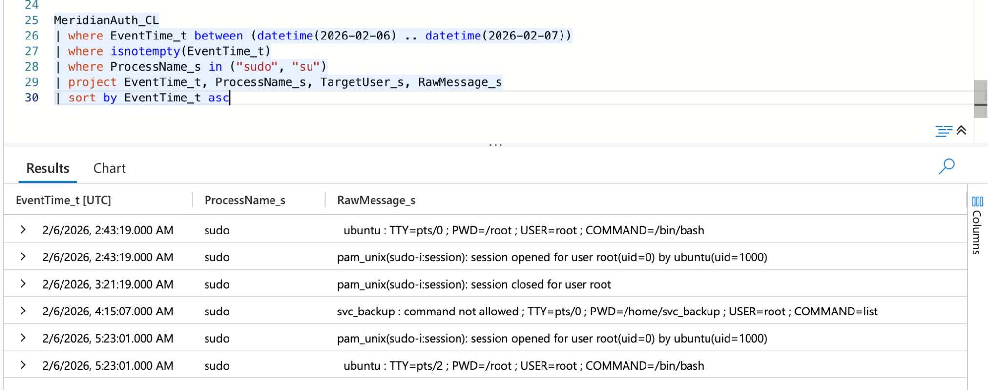

*Figure 7.5a: A15 output (sudo records, full day). Administrator sessions at 02:43:19 to 03:21:19 and from 05:23:01, and the svc_backup denial at 04:15:07.*

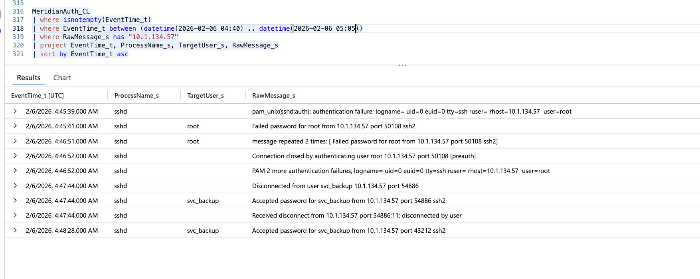

*Figure 7.5b: A18 output. Failed root passwords from 10.1.134.57 port 50108 (04:45:39 to 04:46:52), then accepted svc_backup logins from ports 54886 (04:47:44) and 43212 (04:48:28).*

### 7.6 Pivot: SUID privilege escalation

**Question:** What binary gave root, and with what invocation?

```kql
MeridianAudit_CL
| where EventTime_t between (datetime(2026-02-06 04:15) .. datetime(2026-02-06 05:00))
| where isnotempty(EventTime_t)
| where auid_s != "0" and euid_s == "0"
| project EventTime_t, comm_s, exe_s, Argv_s, auid_s, euid_s
| sort by EventTime_t asc
```

**Returned:** Three rows. rootbash, /tmp/rootbash, "/tmp/rootbash -p", auid_s = 1001, euid_s = 0 at 2026-02-06 04:40:15. sshd, /usr/sbin/sshd, auid_s = 1001, euid_s = 0 at 04:47:44 and at 04:48:28.

**Read:** The -p flag stops bash dropping the effective UID it inherits from the SUID bit. auid_s = 1001 ties the execution to the svc_backup login; euid_s = 0 shows effective root. The two sshd rows are the privileged sshd processes serving the svc_backup logins at 04:47:44 and 04:48:28 (7.8), not attacker binaries; they are the legitimate twin a broad auid/euid hunt must exclude (see D4). How /tmp/rootbash was staged is not recorded (Blind Spot 2). rootbash stayed running until the sweep killed it as PID 265440 at 05:05:01 (Figure 7.8d).

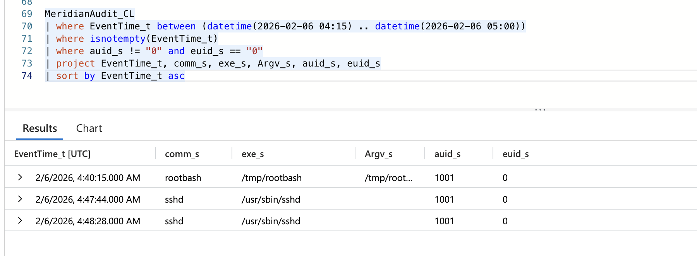

*Figure 7.6a: A6 output. rootbash -p at 04:40:15 with auid 1001 and euid 0, plus the two sshd session processes at 04:47:44 and 04:48:28.*

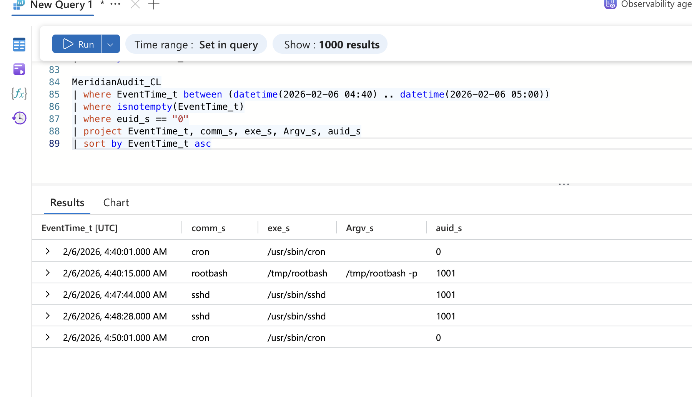

*Figure 7.6b: All euid 0 executions from 04:40 to 05:00. Root CRON runs at 04:40:01 and 04:50:01 bracket rootbash and the two sshd sessions. No health_check execution is recorded in this window.*

### 7.7 Pivot: Second backdoor location

**Question:** Where is the better-hidden second backdoor?

```kql
MeridianSnapshot_CL
| where isnotempty(EventTime_t)
| where isnotempty(ProcBeaconExeLink_s)
| project ProcBeaconName_s, ProcBeaconExeLink_s, ProcBeaconUid_s, ProcBeaconPPid_s
```

**Returned:** ProcBeaconName_s = health_check. ProcBeaconExeLink_s = "lrwxrwxrwx 1 root root 0 Feb 6 04:51 /proc/267155/exe -\> /opt/meridian/scripts/health_check". ProcBeaconUid_s = "1001 0 0 0". ProcBeaconPPid_s = 1 (Figure 7.7a).

Additional confirmation from MeridianDefender_CL SWEEP at 2026-02-06 05:05:06: "Non-baseline file in scripts/: health_check". The sweep flagged it and did not remove it.

**Read:** The second backdoor sits in the application's own scripts directory under a name that reads as routine maintenance. ProcBeaconUid_s is the Uid line from /proc/267155/status, in the order real, effective, saved, filesystem: real UID 1001 (svc_backup) with effective, saved and filesystem UID 0. That is a SUID-root binary run by svc_backup. PPid 1 means its launching process exited and init adopted it. ProcBeaconExeLink_s is an ls -l of /proc/267155/exe. The kernel stamps a /proc entry when it is first instantiated, which is at or after process start, so health_check was running by 2026-02-06 04:51 (Confidence: Medium that it started at or shortly before 04:51). The host clock is UTC: the raw sudo line inside the Defender AUTH event at 04:15:07 carries the same 04:15:07 (Figure 7.4b). The link resolves to /opt/meridian/scripts/health_check with no "(deleted)" marker, so the binary was still on disk at snapshot time, which agrees with the sweep finding the file at 05:05:06. MeridianAudit_CL has no execution record for it in the 04:40 to 05:00 euid 0 review (Figure 7.6b), so how it was launched is not established. A 04:51 bound falls during the attacker's blocked 04:48:28 SSH session and about 3 minutes after the one-second 04:47:44 session; either could have staged or launched it (Confidence: Low).

**Two-source corroboration:** MeridianSnapshot_CL confirms the process at end of window. MeridianDefender_CL SWEEP confirms the file in the same directory at 05:05:06.

**Baseline separation:** The legitimate twin is /opt/meridian/scripts/backup.sh, which MeridianSyslog_CL shows CRON running as root at 04:40:01 and 04:50:01 (two runs in the 04:40 to 05:00 window, A16). The discriminator is the launch source and identity: backup.sh is launched by CRON as root on a 10-minute schedule; health_check has no CRON or systemd launch record, runs with real UID 1001, and is orphaned to PID 1.

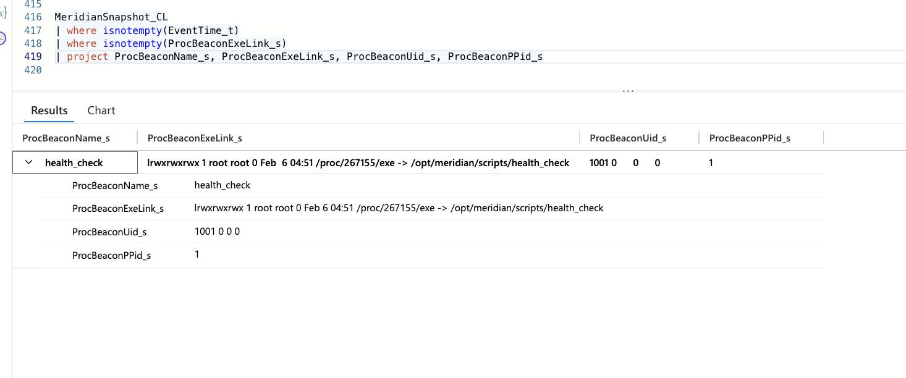

*Figure 7.7a: A7 output, expanded. health_check: /proc/267155/exe link stamped Feb 6 04:51 pointing to /opt/meridian/scripts/health_check; Uid line 1001 0 0 0; PPid 1.*

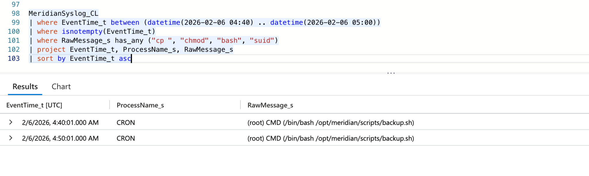

*Figure 7.7b: Baseline for the scripts directory. The only syslog activity matching cp, chmod, bash or suid from 04:40 to 05:00 is the scheduled root CRON run of backup.sh.*

### 7.8 Pivot: Return SSH sessions and the blocked "exfil" traffic

**Question:** What produced the NETWORK "Blocked exfil" events, and were they the health_check backdoor beaconing?

```kql
MeridianDefender_CL
| where EventTime_t between (datetime(2026-02-06 04:40) .. datetime(2026-02-06 05:30))
| where isnotempty(EventTime_t)
| project EventTime_t, EventCategory_s, RawMessage_s
| sort by EventTime_t asc
```

```kql
MeridianAuth_CL
| where isnotempty(EventTime_t)
| where EventTime_t between (datetime(2026-02-06 04:40) .. datetime(2026-02-06 05:05))
| where RawMessage_s has "10.1.134.57"
| project EventTime_t, ProcessName_s, TargetUser_s, RawMessage_s
| sort by EventTime_t asc
```

**Returned:**

1.  **Defender NETWORK (A8, A21):** 73 "Blocked exfil to 10.1.134.57:43212 from 10.1.15.67" events from 04:48:28 to 05:02:17. A24 groups the blocks by destination and returns one row: 10.1.134.57:43212, 73 blocks (Figure 7.8f). A burst at 04:48:28 to 04:48:29 is followed by gaps of 1, 1, 1, 3, 7, 13, 26, 54 and 106 seconds, then pairs roughly 120 seconds apart until 05:02:17.

2.  **MeridianAuth_CL (A18):** "Accepted password for svc_backup from 10.1.134.57 port 54886 ssh2" at 04:47:44, with "Received disconnect" and "Disconnected from user svc_backup" in the same second. "Accepted password for svc_backup from 10.1.134.57 port 43212 ssh2" at 04:48:28.

3.  **MeridianDefender_CL SSH (A19):** "Login 'svc_backup' from 10.1.134.57" at 04:47:44 and at 04:48:28, the second in the same second as the first block (Figure 7.8a).

4.  **MeridianAudit_CL (A6):** sshd with auid 1001 and euid 0 at 04:47:44 and 04:48:28 (Figure 7.6a).

5.  **MeridianSyslog_CL (A9):** kernel NETMON_EXFIL lines with SPT=22 and DPT=43212.

**Read:** Port 43212 is the attacker's client port for the SSH session accepted at 04:48:28. The blocked packets leave the server from port 22. The defense stack therefore blocked the server's replies to the attacker's own SSH session and labelled them "exfil" (Confidence: High; exact IP and port match across MeridianAuth_CL, MeridianDefender_CL and MeridianSyslog_CL, and the first block falls in the login's second). The gaps double and then cap near 120 seconds. That is the shape of TCP retransmission backoff for unacknowledged segments, not a beacon timer (Confidence: Medium). Inbound packets from the attacker were not blocked, so commands sent in this session may still have reached sshd; whether any ran is not established. The session at 04:47:44 opened and closed within one second. That fits a single non-interactive command or a file copy rather than an interactive shell (Confidence: Medium). What it carried is not established.

**Counter-hypothesis 2 test:** If health_check were beaconing, the blocks would name a destination port unrelated to any SSH session, keep a fixed interval, and continue for as long as PID 267155 ran. Observed: the only destination port equals the 04:48:28 SSH client port, the interval follows a backoff curve, and the blocks stop at 05:02:17 while health_check keeps running to the end of the window. Counter-hypothesis 2 is rejected. No telemetry attributes any network activity to health_check, and its purpose is not established (Blind Spot 7).

**Containment implication:** The network block did not contain a C2 channel; it disrupted the attacker's SSH session. It gives no assurance about health_check, which is unaffected by it.

**Dead end:** I first queried MeridianNetwork_CL for outbound connections. It holds only listening sockets (State_s = LISTEN, wildcard PeerAddress_s) and has no RawMessage_s column. Three queries returned nothing relevant (A17).

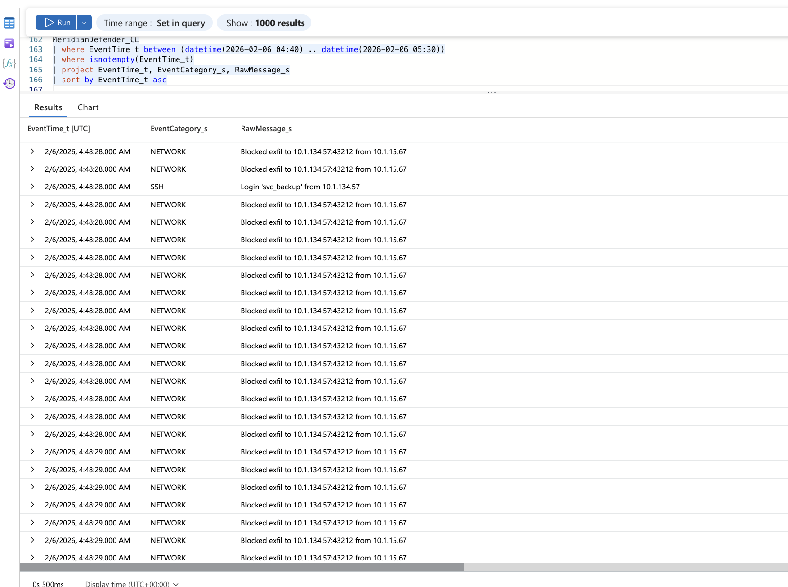

*Figure 7.8a: Defender events from 04:40. The svc_backup SSH login at 04:48:28 sits inside the first second of NETWORK blocks to 10.1.134.57:43212.*

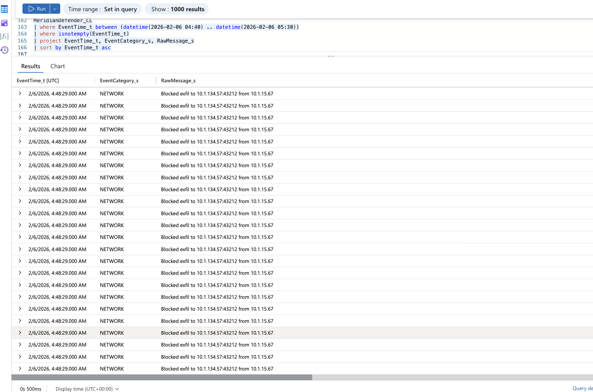

*Figure 7.8b: The block burst continues through 04:48:29, all to 10.1.134.57:43212.*

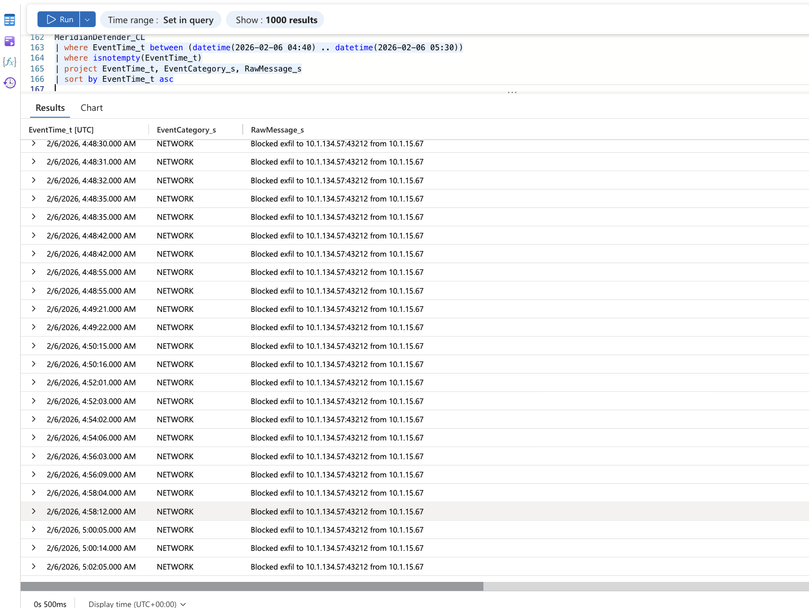

*Figure 7.8c: After the burst the gaps grow (04:48:30, :31, :32, :35, :42, :55, 04:49:21, 04:50:15, 04:52:01) and then settle near two minutes, ending 05:02:05.*

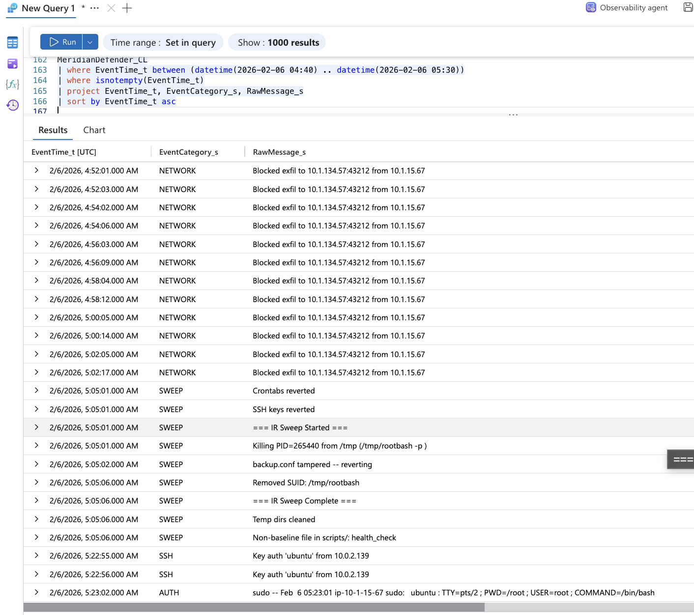

*Figure 7.8d: Final blocks at 05:02:05 and 05:02:17, the 05:05 IR sweep (rootbash PID 265440 killed, backup.conf reverted, health_check flagged), and the administrator key login from 10.0.2.139 at 05:22:55.*

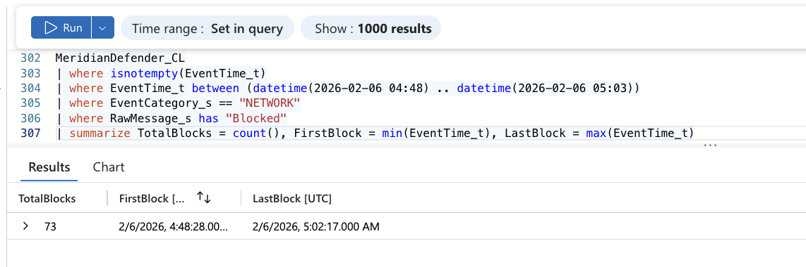

*Figure 7.8e: A21 output. 73 NETWORK blocks, first at 04:48:28 and last at 05:02:17.*

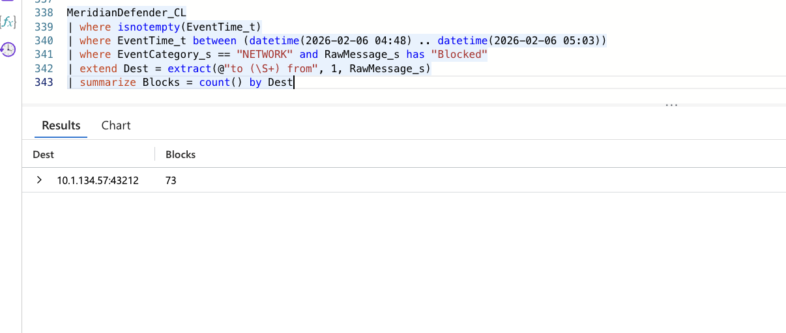

*Figure 7.8f: A24 output. All 73 blocks share a single destination, 10.1.134.57:43212.*

### 7.9 Pivot: Patient data export

**Question:** What was exported, and does any second source show the request behind the export event?

```kql
MeridianDefender_CL
| where isnotempty(EventTime_t)
| where EventCategory_s == "WEB"
| where RawMessage_s has "export"
| project EventTime_t, RawMessage_s
```

**Returned:** MeridianDefender_CL WEB: "Patient data export from 10.1.134.57" at 2026-02-06 03:56:28. Second-source tests, all with an explicit TimeGenerated filter: no request from 10.1.134.57 between 03:56:20 and 03:56:35 by URI keyword (A20), by non-gobuster user-agent (A25), with status 200 (A26), or at all (A27) (Figure 7.9a). The full attacker request list from 03:55:09 to 04:08:00 (A29, Figure 7.9b) has /backups/ (404) at 03:55:33 and GET / (200, 1,888 bytes) at 03:56:40, and nothing between them. No request in the list targets an export, report or download URI. MeridianMySQL_CL has no rows after 03:20:01 (A23).

**Read:** The export event has no matching request in any table. The nearest attacker requests are 55 seconds before and 12 seconds after it, and neither is an export URI. gobuster finished at 03:55:08, so a scanner request cannot explain it either. This is a named discrepancy, not a confirmation. Three explanations remain open: the defense stack mislabelled an event, as it did twice elsewhere (7.8, 7.14); the export ran through a path the access log does not record; or the event timestamp is wrong. Whether patient data was exported is not established (Confidence that an export occurred: Low). For regulatory purposes the conservative position holds: the attacker had portal access and a recorded export, so the incident is treated as a possible breach until the export is ruled out (section 15).

**Baseline separation:** The only other patient-data event in MeridianDefender_CL is "DB: Full patient table query" at 02:58:26, 49 minutes before the first attacker request, during defense-stack bootstrap (F11). MeridianMySQL_CL shows that event as meridian_app running SELECT count(\*) FROM patients at 02:58:26.876 (A23, Figure 7.14), a row count rather than a table dump. Discriminators: EventCategory_s (WEB versus DB) and the source address in RawMessage_s (10.1.134.57 versus none). Counts: one WEB export from the attacker address; one DB query during bootstrap.

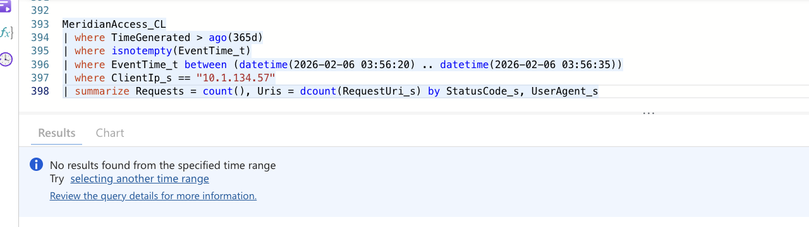

*Figure 7.9a: A27 output. No request of any kind from 10.1.134.57 between 03:56:20 and 03:56:35.*

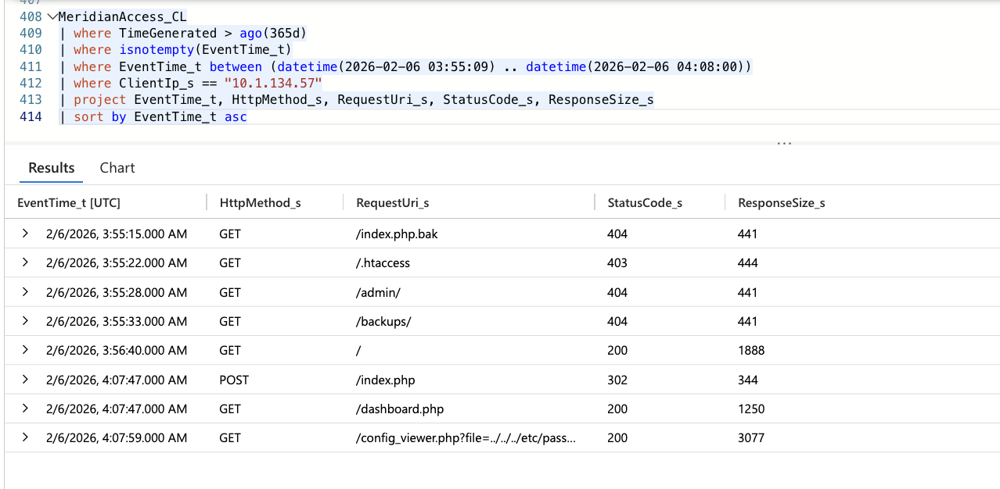

*Figure 7.9b: A29 output. Every attacker request from 03:55:09 to 04:08:00: manual curl probes to 03:55:33, GET / at 03:56:40, the second portal login at 04:07:47 and the /etc/passwd read. Nothing at 03:56:28.*

### 7.10 Pivot: Tampered backup configuration

**Question:** Which config file did the sweep revert as tampered?

```kql
MeridianDefender_CL
| where isnotempty(EventTime_t)
| where EventTime_t between (datetime(2026-02-06 05:04) .. datetime(2026-02-06 05:06))
| where EventCategory_s == "SWEEP"
| where RawMessage_s has "tampered"
| project EventTime_t, RawMessage_s
```

**Returned:** "backup.conf tampered -- reverting" at 2026-02-06 05:05:02 UTC.

**Read:** backup.conf changed between the 03:08 sweep and the 05:05 sweep. The only root sessions in that interval were the administrator's sudo session, which closed at 03:21:19 (A15), and the attacker's rootbash shell from 04:40:15. The change is attributed to the attacker (Confidence: Medium). Its purpose, such as redirecting or breaking backups, is not established. The sweep reverted it.

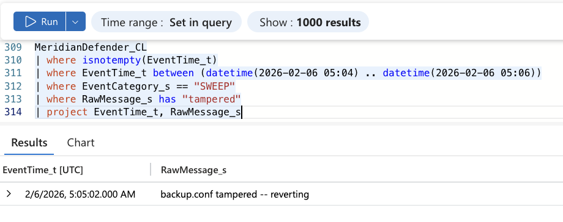

*Figure 7.10: A11 output. The 05:05:02 SWEEP entry reverting backup.conf.*

### 7.11 Pivot: Defense stack bootstrap noise versus real intrusion

**Question:** Is the pre-intrusion detection burst (02:53 to 03:08) part of the attack or self-generated noise?

```kql
MeridianDefender_CL
| where isnotempty(EventTime_t)
| where EventTime_t between (datetime(2026-02-06 02:42) .. datetime(2026-02-06 03:47))
| project EventTime_t, EventCategory_s, RawMessage_s
| sort by EventTime_t asc
```

**Returned:** 18 events between 02:53:31 and 03:08:22: 9 DETECTION (crontab modification, SSH key modification and new systemd service, 02:53:31 to 02:53:32), 1 SSH ("Login 'svc_backup' from 127.0.0.1" at 02:56:33), 1 DB ("Full patient table query" at 02:58:26) and 7 SWEEP (03:08:17 to 03:08:22, including the removal of sysmon.service).

**Read:** Every event predates the first attacker request (03:47:32) by at least 39 minutes. The SSH login comes from 127.0.0.1, not the attacker. Each DETECTION line is marked "reverting" in the same second it fires, which is a baseline-revert system treating its own setup as tampering. This is defense-stack bootstrap noise (Confidence: High).

**Counter-hypothesis test:** If the burst were attacker activity, 10.1.134.57 would appear in the access or auth logs before 03:47. MeridianAccess_CL has no request from 10.1.134.57 before 03:47:32 (A1 first-seen). MeridianAuth_CL has no SSH login from 10.1.134.57 before 04:09:31. The counter-hypothesis is disproved.

**The 05:05 sweep revert lines:** The 05:05:01 sweep logged "SSH keys reverted" and "Crontabs reverted", the same lines the 03:08 sweep logged. A19 returns no DETECTION events at all between 03:09 and 05:05 (Figure 7.4b). The revert lines therefore read as standard sweep output rather than evidence of attacker cron or key changes (Confidence: Medium). The same silence shows the real-time detector raised nothing while rootbash, health_check and the backup.conf change appeared (Blind Spot 6).

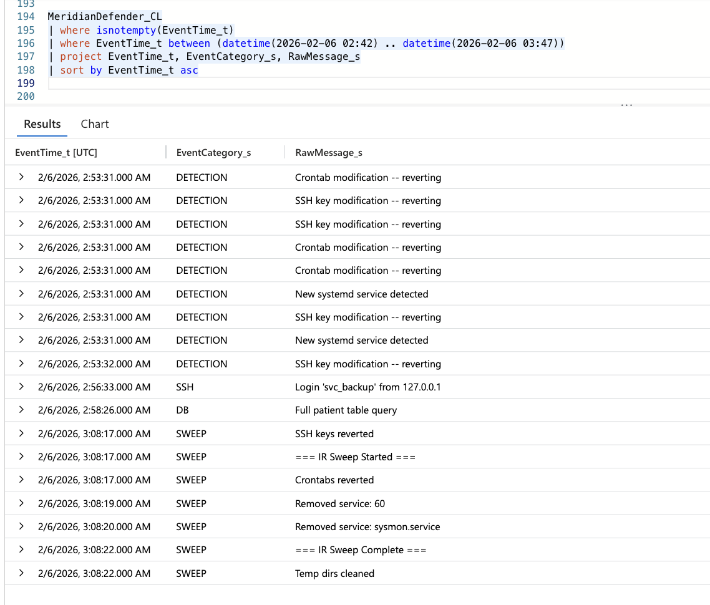

*Figure 7.11: A12 output. All 18 Defender events before the first attacker request: 9 DETECTION, 1 SSH from 127.0.0.1, 1 DB and 7 SWEEP.*

### 7.12 Pivot: Collateral damage from bootstrap sweep

**Question:** What did the bootstrap sweep remove that was not the attacker's?

```kql
MeridianDefender_CL
| where isnotempty(EventTime_t)
| where EventCategory_s == "SWEEP"
| where RawMessage_s has "Removed service"
| where EventTime_t < datetime(2026-02-06 03:10:00)
| project EventTime_t, RawMessage_s
```

**Returned:** Two service removals. "Removed service: 60" at 2026-02-06 03:08:19. "Removed service: sysmon.service" at 2026-02-06 03:08:20.

**Read:** The sweep treated sysmon.service as non-baseline and removed it. "Removed service: 60" is most likely a parsing artifact rather than a real unit name (Confidence: Low). Sysmon for Linux provides command-line and parent-child process logging. Its removal 39 minutes before the first attacker request left the intrusion without that visibility. The gap was created by the defense stack's own baseline logic, not by the attacker.

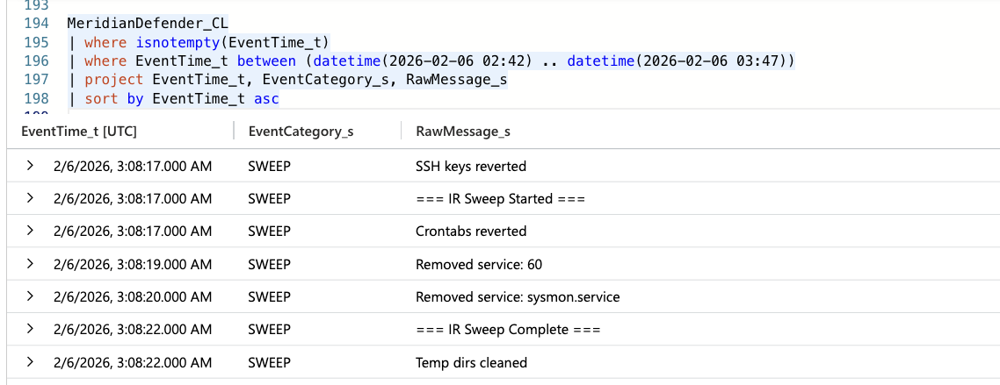

*Figure 7.12: Bootstrap SWEEP rows (crop of the A12 output in Figure 7.11). sysmon.service removed at 03:08:20.*

### 7.13 Pivot: IR response and evidence capture

**Question:** What tool did the returning admin use to capture volatile state?

```kql
MeridianAudit_CL
| where isnotempty(EventTime_t)
| where Types_s has "EXECVE"
| where EventTime_t > datetime(2026-02-06 05:25:00)
| where Argv_s has "avml" or comm_s has "avml"
| project EventTime_t, Argv_s, exe_s
```

**Returned:** Two executions of "/tmp/avml /tmp/evidence/memory.lime", at 2026-02-06 05:27:48 and 05:28:24, run by auid 1000 (ubuntu) with euid 0.

**Read:** avml (Acquire Volatile Memory for Linux) wrote a memory image to /tmp/evidence/memory.lime. The administrator logged in by key from 10.0.2.139 at 05:22:55 to 05:22:56 (Defender SSH, Figure 7.8d) and ran sudo -i at 05:23:01 (A15) before the capture. Volatile state was captured before anyone touched the live backdoor, which is the correct forensic order.

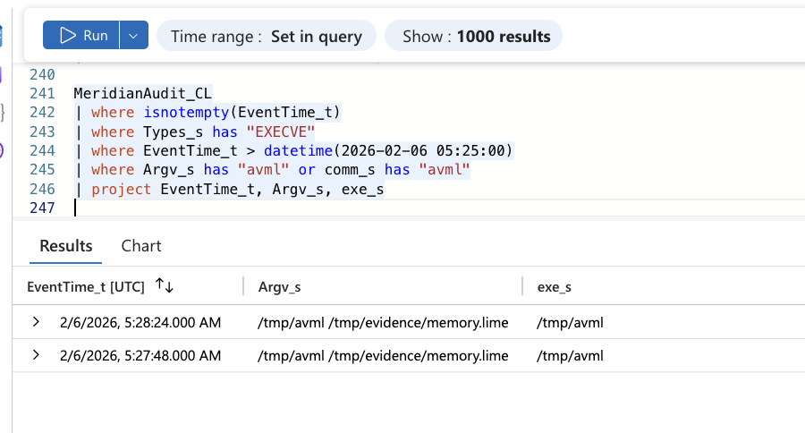

*Figure 7.13: A14 output. avml memory capture at 05:27:48 and 05:28:24.*

### 7.14 Pivot: MySQL general log coverage

**Question:** Does MeridianMySQL_CL show the portal login, the 03:56:28 export, or SQL injection?

```kql
MeridianMySQL_CL
| where TimeGenerated > ago(365d)
| summarize Rows = count(),
WithEventTime = countif(isnotempty(EventTime_t)),
FirstIngest = min(TimeGenerated), LastIngest = max(TimeGenerated)
```

```kql
MeridianMySQL_CL
| where TimeGenerated > ago(365d)
| where isnotempty(EventTime_t)
| sort by EventTime_t asc
```

**Returned:** 16 rows, all ingested at 2026-08-30 09:18:04 (A22). By EventTime_t they run from 02:53:30 to 03:20:01 (A23): SET GLOBAL log_output = 'FILE' at 02:53:30; meridian_app connecting to meridian_patients and running SELECT \* FROM portal_flags at 02:57:11; meridian_app running SELECT count(\*) FROM patients at 02:58:26; and "Access denied for user 'root'@'localhost' (using password: NO)" at 03:00:01, 03:10:01 and 03:20:01. Nothing after 03:20:01.

**Read:** The general log ends 27 minutes before the first attacker request (03:47:32). It cannot confirm or rule out the portal login, the export query or SQL injection; that is a coverage gap, not a negative (G7). Why it stops is not established: CRON keeps firing at 04:40:01 and 04:50:01, so the root denials would have continued if logging had. The log does add three things. It gives the 02:58:26 Defender "Full patient table query" a second source, and shows it was a row count by the application account. It shows general logging was switched on at 02:53:30, the same second as the bootstrap DETECTION burst. And the root denials every 10 minutes at :00:01 match the backup.sh CRON cadence, so the scheduled backup was most likely failing to reach MySQL without a password before the attack began (Confidence: Medium).

**Baseline separation:** All 16 rows come from localhost sockets (meridian_app and root). No row names 10.1.134.57 or any remote client. Discriminator: the client account and host in Argument_s.

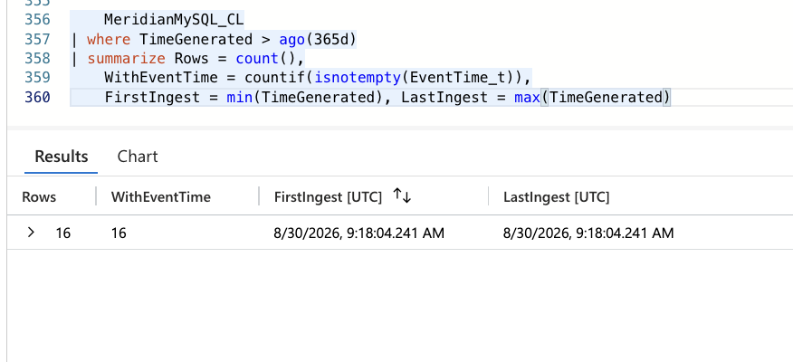

*Figure 7.14a: A22 output. 16 MySQL rows, ingested in a single batch on 2026-08-30.*

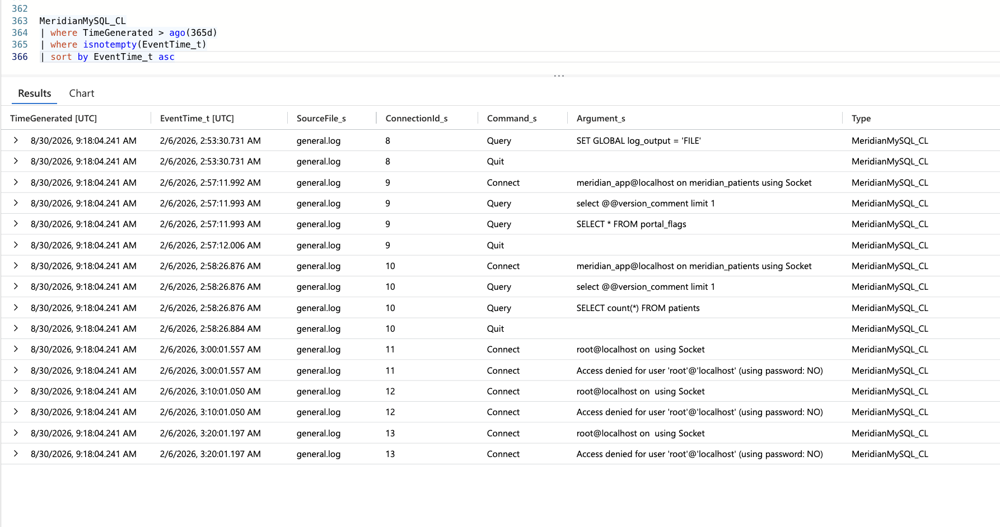

*Figure 7.14b: A23 output. The full general log: bootstrap queries at 02:53 to 02:58 and root access denials at 03:00:01, 03:10:01 and 03:20:01, ending 27 minutes before the attack.*

### 7.15 Dead Ends

| **Hypothesis tested**                                                       | **Query / Table**                                                                         | **Result**                                                                                                                                                  | **Why rejected**                                                                            |
|-----------------------------------------------------------------------------|-------------------------------------------------------------------------------------------|-------------------------------------------------------------------------------------------------------------------------------------------------------------|---------------------------------------------------------------------------------------------|
| C2 connections visible in MeridianNetwork_CL                                | MeridianNetwork_CL filtered by PeerAddress_s containing 10.1.134.57 (A17)                 | Only listening sockets (State LISTEN, wildcard peers)                                                                                                       | Table captures socket state, not connections. Pivoted to Defender NETWORK and kernel syslog |
| health_check is the source of the "Blocked exfil" traffic                   | MeridianAuth_CL (A18), MeridianDefender_CL (A8, A19), MeridianSyslog_CL (A9)              | Destination port 43212 equals the client port of the 04:48:28 SSH login; source port 22; backoff timing; blocks stop at 05:02:17 while health_check runs on | Traffic is the SSH session's return path. See 7.8                                           |
| Export triggered by the gobuster scan                                       | MeridianAccess_CL client and user-agent summary 03:55 to 04:08 (A28)                      | gobuster ran 03:55:05 to 03:55:08 only                                                                                                                      | Scan ended 80 seconds before the export event                                               |
| Export request identifiable in web logs                                     | MeridianAccess_CL, 03:56:20 to 03:56:35 (A20, A25, A26, A27) and full list to 04:08 (A29) | Zero rows; no export URI in the list                                                                                                                        | No web request corresponds to the export event                                              |
| Attacker used kernel exploits or pkexec                                     | MeridianAudit_CL, Argv_s containing sudo, su, exploit, kernel, pkexec, CVE                | Zero rows                                                                                                                                                   | No kernel exploit or pkexec evidence                                                        |
| svc_backup has sudo privileges                                              | MeridianAuth_CL at 04:15:07 (A5, A15)                                                     | "command not allowed"                                                                                                                                       | sudo explicitly denied for svc_backup                                                       |
| Root SSH login succeeds                                                     | MeridianAuth_CL 04:44 to 04:46 (A5, A18)                                                  | 6 failed passwords (3 from 10.1.15.67, 3 from 10.1.134.57), 0 accepted                                                                                      | Root password login refused                                                                 |
| SUID binary staging visible in audit logs                                   | MeridianAudit_CL filtered for cp, chmod, bash, sh with euid 0                             | Execution records for rootbash only                                                                                                                         | Audit policy does not log file copy or permission changes on these paths                    |
| Pre-intrusion DB query is attacker activity                                 | MeridianDefender_CL DB event at 02:58:26 (A12)                                            | "Full patient table query", no attacker address                                                                                                             | 49 minutes before first attacker request; bootstrap noise                                   |
| MeridianNetwork_CL has a RawMessage_s column                                | Query filtering on RawMessage_s                                                           | Column does not exist                                                                                                                                       | Different schema from other Meridian tables                                                 |
| amazon-ssm-agent errors are attacker-related                                | MeridianSyslog_CL at 04:19, 04:48, 05:13                                                  | EC2RoleProvider failures for account 662863940582                                                                                                           | Missing IAM role; recurs on its own schedule regardless of intrusion                        |
| MySQL shows the export or SQL injection                                     | MeridianMySQL_CL, all rows (A22, A23)                                                     | 16 rows, 02:53:30 to 03:20:01                                                                                                                               | Log ends 27 minutes before the first attacker request; untestable, not negative             |
| 05:05 "SSH keys reverted" and "Crontabs reverted" show attacker persistence | MeridianDefender_CL DETECTION, SSH, AUTH 03:09 to 05:05 (A19)                             | No DETECTION events; identical lines in the 03:08 sweep                                                                                                     | Lines are standard sweep output, not evidence of attacker changes                           |

## 08 UTC Timeline

| **Time (UTC)**      | **Event**                                                                                                                                        | **Source**                                                                   | **Evidence ref** |
|---------------------|--------------------------------------------------------------------------------------------------------------------------------------------------|------------------------------------------------------------------------------|------------------|
| 2026-02-06 02:53:30 | MySQL general logging enabled (SET GLOBAL log_output)                                                                                            | MeridianMySQL_CL                                                             | 7.14             |
| 2026-02-06 02:53:31 | Defense stack bootstrap: 9 DETECTION events (crontab, SSH key, systemd service), each auto-reverted                                              | MeridianDefender_CL (DETECTION)                                              | 7.11             |
| 2026-02-06 02:56:33 | Bootstrap SSH login svc_backup from 127.0.0.1                                                                                                    | MeridianDefender_CL (SSH)                                                    | 7.11             |
| 2026-02-06 02:58:26 | Bootstrap "Full patient table query" (MySQL: meridian_app SELECT count(\*) FROM patients)                                                        | MeridianDefender_CL (DB); MeridianMySQL_CL                                   | 7.11, 7.14       |
| 2026-02-06 03:08:17 | Bootstrap sweep starts: SSH keys and crontabs reverted                                                                                           | MeridianDefender_CL (SWEEP)                                                  | 7.11             |
| 2026-02-06 03:08:20 | Bootstrap sweep removes sysmon.service (collateral damage)                                                                                       | MeridianDefender_CL (SWEEP)                                                  | 7.12             |
| 2026-02-06 03:08:22 | Bootstrap sweep completes; temp dirs cleaned                                                                                                     | MeridianDefender_CL (SWEEP)                                                  | 7.11             |
| 2026-02-06 03:20:01 | Last MySQL general log row (root access denied); no MySQL coverage after this                                                                    | MeridianMySQL_CL                                                             | 7.14             |
| 2026-02-06 03:47:32 | First attacker request: Nmap from 10.1.134.57 (29 requests + 4 empty user-agent)                                                                 | MeridianAccess_CL                                                            | 7.1              |
| 2026-02-06 03:52:09 | curl reconnaissance begins (16 requests)                                                                                                         | MeridianAccess_CL                                                            | 7.2              |
| 2026-02-06 03:52:21 | GET /robots.txt (200)                                                                                                                            | MeridianAccess_CL                                                            | 7.2              |
| 2026-02-06 03:52:29 | GET /config_viewer.php (302, unauthenticated)                                                                                                    | MeridianAccess_CL                                                            | 7.2              |
| 2026-02-06 03:53:36 | First POST /index.php (portal login sequence)                                                                                                    | MeridianAccess_CL                                                            | 7.2              |
| 2026-02-06 03:54:09 | GET /dashboard.php (200): authenticated portal session; credential source not established                                                        | MeridianAccess_CL                                                            | 7.2              |
| 2026-02-06 03:54:54 | WhatWeb/0.6.3 fingerprint (1 request)                                                                                                            | MeridianAccess_CL                                                            | 7.1              |
| 2026-02-06 03:55:05 | gobuster/3.8.2 directory scan begins (18,454 requests)                                                                                           | MeridianAccess_CL                                                            | 7.1              |
| 2026-02-06 03:55:08 | gobuster scan ends (4 seconds in total)                                                                                                          | MeridianAccess_CL                                                            | 7.1              |
| 2026-02-06 03:55:15 | Manual curl probes: /index.php.bak, /.htaccess, /admin/, /backups/ (to 03:55:33), all 403 or 404                                                 | MeridianAccess_CL                                                            | 7.2              |
| 2026-02-06 03:56:28 | "Patient data export from 10.1.134.57"; no matching request in any table (uncorroborated)                                                        | MeridianDefender_CL (WEB)                                                    | 7.9              |
| 2026-02-06 03:56:40 | GET / (200); last attacker web request for 11 minutes                                                                                            | MeridianAccess_CL                                                            | 7.9              |
| 2026-02-06 04:07:47 | Second portal login: POST /index.php (302), GET /dashboard.php (200)                                                                             | MeridianAccess_CL                                                            | 7.2              |
| 2026-02-06 04:07:59 | LFI reads /etc/passwd via ../../../ traversal (3,077 bytes)                                                                                      | MeridianAccess_CL                                                            | 7.3              |
| 2026-02-06 04:08:34 | LFI reads database.conf (1,231 bytes)                                                                                                            | MeridianAccess_CL                                                            | 7.3              |
| 2026-02-06 04:09:31 | SSH password login svc_backup from 10.1.134.57 port 39206                                                                                        | MeridianAuth_CL; MeridianDefender_CL (SSH)                                   | 7.4              |
| 2026-02-06 04:15:07 | sudo denied for svc_backup ("command not allowed")                                                                                               | MeridianAuth_CL; MeridianDefender_CL (AUTH)                                  | 7.5              |
| 2026-02-06 04:40:01 | Scheduled root CRON run of backup.sh (baseline)                                                                                                  | MeridianSyslog_CL; MeridianAudit_CL                                          | 7.7              |
| 2026-02-06 04:40:15 | /tmp/rootbash -p executed: auid 1001 (svc_backup), euid 0                                                                                        | MeridianAudit_CL                                                             | 7.6              |
| 2026-02-06 04:44:27 | Root SSH attempts begin from 10.1.15.67 (Defender attempts 1 and 2 at 04:44:27, 04:44:59)                                                        | MeridianDefender_CL (SSH); MeridianAuth_CL                                   | 7.5              |
| 2026-02-06 04:45:41 | Failed root password from 10.1.134.57 port 50108; two more by 04:46:51                                                                           | MeridianAuth_CL; MeridianDefender_CL (SSH)                                   | 7.5              |
| 2026-02-06 04:46:52 | Root attempt connection closed \[preauth\]; 6 failed root passwords total, 0 accepted                                                            | MeridianAuth_CL                                                              | 7.5              |
| 2026-02-06 04:47:44 | SSH login svc_backup from 10.1.134.57 port 54886; disconnected the same second                                                                   | MeridianAuth_CL; MeridianDefender_CL (SSH); MeridianAudit_CL (sshd)          | 7.8              |
| 2026-02-06 04:48:28 | SSH login svc_backup from 10.1.134.57 port 43212; first "Blocked exfil to 10.1.134.57:43212" in the same second                                  | MeridianAuth_CL; MeridianDefender_CL (SSH, NETWORK); MeridianAudit_CL (sshd) | 7.8              |
| 2026-02-06 04:50:01 | Scheduled root CRON run of backup.sh (baseline)                                                                                                  | MeridianSyslog_CL; MeridianAudit_CL                                          | 7.7              |
| 2026-02-06 04:51:00 | health_check (PID 267155) running by this time: /proc exe link timestamp; start at or before 04:51                                               | MeridianSnapshot_CL (ProcBeaconExeLink_s)                                    | 7.7              |
| 2026-02-06 05:02:17 | Last of 73 NETWORK blocks on the port 43212 session                                                                                              | MeridianDefender_CL (NETWORK)                                                | 7.8              |
| 2026-02-06 05:05:01 | IR sweep starts: kills rootbash (PID 265440); routine SSH key and crontab revert lines                                                           | MeridianDefender_CL (SWEEP)                                                  | 7.8, 7.11        |
| 2026-02-06 05:05:02 | Sweep reverts tampered backup.conf                                                                                                               | MeridianDefender_CL (SWEEP)                                                  | 7.10             |
| 2026-02-06 05:05:06 | Sweep removes SUID from /tmp/rootbash, cleans temp dirs, flags health_check in scripts/ but does not remove it                                   | MeridianDefender_CL (SWEEP)                                                  | 7.7              |
| 2026-02-06 05:22:55 | Administrator ubuntu logs in by SSH key from 10.0.2.139                                                                                          | MeridianDefender_CL (SSH); MeridianAuth_CL                                   | 7.13             |
| 2026-02-06 05:23:01 | Administrator runs sudo -i                                                                                                                       | MeridianAuth_CL; MeridianDefender_CL (AUTH)                                  | 7.13             |
| 2026-02-06 05:27:48 | avml memory capture to /tmp/evidence/memory.lime (repeated 05:28:24)                                                                             | MeridianAudit_CL                                                             | 7.13             |
| 2026-02-06 05:30:00 | End of observation window (snapshot): health_check (PID 267155) running, Uid line 1001 0 0 0, binary still at /opt/meridian/scripts/health_check | MeridianSnapshot_CL                                                          | 7.7              |

The 04:51:00 row is a bound from the /proc link timestamp (minute precision), not a logged execution event. The 05:30:00 row marks the end of the observation window, when the snapshot was read.

## 09 Findings

### F1: Four-tool reconnaissance with a deliberate pre-scan request to config_viewer.php

**State it:** The attacker used four tools in sequence (Nmap, curl, WhatWeb, gobuster) and requested config_viewer.php by name before running any wordlist scan.

**Show it:** MeridianAccess_CL, ClientIp_s = 10.1.134.57 (A1, Figure 7.1). First seen by UserAgent_s: Nmap Scripting Engine 03:47:32 (29 requests), curl/8.18.0 03:52:09 (16), WhatWeb/0.6.3 03:54:54 (1), gobuster/3.8.2 03:55:05 (18,454). Four requests with UserAgent_s "-" share Nmap's first-seen second. curl requested /robots.txt at 03:52:21 and /config_viewer.php at 03:52:29 (A2, Figure 7.2). gobuster never requested config_viewer.php (A3, Figure 7.3).

**Interpret it:** T1595 Active Scanning; T1595.003 Wordlist Scanning for gobuster. The config_viewer.php request was deliberate (Confidence: High). Whether the attacker knew the endpoint before the session or read it from robots.txt eight seconds earlier is not established, because robots.txt content is not logged (Confidence in prior knowledge: Low). gobuster contributed nothing to the intrusion path, since it never found the endpoint that was exploited.

### F2: Unrestricted file read through config_viewer.php

**State it:** The config_viewer.php file parameter returned files outside the web root through path traversal, and arbitrary files by bare name.

**Show it:** MeridianAccess_CL, ClientIp_s = 10.1.134.57, StatusCode_s = 200 (A3, Figure 7.3). RequestUri_s /config_viewer.php?file=../../../etc/passwd at 2026-02-06 04:07:59, ResponseSize_s = 3,077. RequestUri_s /config_viewer.php?file=database.conf at 2026-02-06 04:08:34, ResponseSize_s = 1,231.

**Interpret it:** T1190 Exploit Public-Facing Application. A 3,077-byte 200 response to a traversal path is consistent with the full /etc/passwd being returned (Confidence: High). The database.conf read needed no traversal, so the parameter has no allowlist at all. The 1,231-byte response most likely contained connection credentials (Confidence: High, from the SSH login 57 seconds later, F3), but the contents are not captured (Blind Spot 3).

### F3: Credential theft and SSH login in 57 seconds

**State it:** The attacker read database.conf through the LFI and logged in to the host by SSH as svc_backup 57 seconds later.

**Show it:** MeridianAccess_CL: database.conf read at 2026-02-06 04:08:34 (A3). MeridianAuth_CL: "Accepted password for svc_backup from 10.1.134.57 port 39206 ssh2" at 2026-02-06 04:09:31 (A4, Figure 7.4a).

**Interpret it:** T1552.001 Credentials In Files; T1078.003 Valid Accounts: Local Accounts. The svc_backup password came from database.conf (Confidence: High; timing, and no failed svc_backup attempts in A5).

**Two-source corroboration:** MeridianDefender_CL SSH logs "Login 'svc_backup' from 10.1.134.57" at 04:09:31, the same second (A19, Figure 7.4b).

**Baseline separation:** Four svc_backup SSH logins in-window: 127.0.0.1 at 02:56:33 (bootstrap) and 10.1.134.57 at 04:09:31, 04:47:44 and 04:48:28. The only other interactive SSH login is ubuntu by key from 10.0.2.139 at 05:22:55. Discriminator: SourceIP. 10.1.134.57 is unique to attacker activity.

### F4: Root-access attempts that failed, before and after the SUID shell

**State it:** svc_backup was refused sudo before the SUID shell, and six direct root SSH passwords were refused after it.

**Show it:** MeridianAuth_CL at 2026-02-06 04:15:07: "svc_backup : command not allowed ; TTY=pts/0 ; PWD=/home/svc_backup ; USER=root ; COMMAND=list" (A5, Figure 7.5a), also MeridianDefender_CL AUTH at 04:15:07 (Figure 7.4b). MeridianAuth_CL 04:44 to 04:46: three "Failed password for root" from 10.1.15.67 and three from 10.1.134.57 port 50108, last at 04:46:51, zero accepted (A5, A18, Figure 7.5b). rootbash ran at 04:40:15 (F5).

**Interpret it:** T1548.003 Sudo and Sudo Caching (attempted, denied); T1110.001 Password Guessing (attempted, failed). Both controls held. The root SSH attempts came four minutes after effective root was already held, so they were not the path to root. The likeliest aim was a direct root login that would outlive the rootbash shell (Confidence: Low).

**Baseline separation:** sudo in-window shows two legitimate ubuntu sessions (opened 02:43:19 and closed 03:21:19; opened 05:23:01) and one denial (A15). Discriminator: the requesting account (ubuntu, uid 1000, permitted, versus svc_backup, denied).

### F5: SUID privilege escalation via /tmp/rootbash

**State it:** The attacker gained effective root by executing a SUID copy of bash at /tmp/rootbash with -p.

**Show it:** MeridianAudit_CL at 2026-02-06 04:40:15: comm_s = rootbash, exe_s = /tmp/rootbash, Argv_s = "/tmp/rootbash -p", auid_s = 1001, euid_s = 0 (A6, Figure 7.6a). MeridianDefender_CL SWEEP at 05:05:01: "Killing PID=265440 from /tmp (/tmp/rootbash -p )"; at 05:05:06: "Removed SUID: /tmp/rootbash" (Figure 7.8d).

**Interpret it:** T1548.001 Setuid and Setgid. -p keeps the effective UID that the SUID bit grants. auid_s = 1001 ties execution to the svc_backup login; euid_s = 0 is effective root. The shell ran for about 25 minutes until the sweep killed it. Its staging (copy and chmod +s) is not captured (Blind Spot 2).

**Two-source corroboration:** MeridianAudit_CL records the execution; MeridianDefender_CL SWEEP independently names the same path and argument line when it kills it.

**Baseline separation:** The other auid 1001 / euid 0 rows in the same query are /usr/sbin/sshd at 04:47:44 and 04:48:28, the privileged session processes for the later logins. Discriminator: exe_s (/tmp/rootbash versus /usr/sbin/sshd).

### F6: Second backdoor disguised as health_check

**State it:** A SUID-root process named health_check, from /opt/meridian/scripts/, was running at the end of the window.

**Show it:** MeridianSnapshot_CL (A7, Figure 7.7a): ProcBeaconName_s = health_check; ProcBeaconExeLink_s = "lrwxrwxrwx 1 root root 0 Feb 6 04:51 /proc/267155/exe -\> /opt/meridian/scripts/health_check"; ProcBeaconUid_s = "1001 0 0 0" (real, effective, saved, filesystem); ProcBeaconPPid_s = 1. MeridianDefender_CL SWEEP at 2026-02-06 05:05:06: "Non-baseline file in scripts/: health_check" (Figure 7.8d).

**Interpret it:** T1036.005 Match Legitimate Name or Location; T1548.001 Setuid and Setgid. The name and directory are chosen to pass a glance alongside backup.sh (Confidence: High). Real UID 1001 links it to svc_backup, and the attacker is the only actor using that account outside bootstrap (Confidence: High). It was running by 04:51 (/proc link timestamp; Confidence: Medium that it started at or shortly before 04:51), inside the window of the attacker's 04:48:28 SSH session. The binary was still on disk at snapshot time. The sweep flags non-baseline files but does not act on running processes. Launch method and purpose are not established; no network activity is attributable to it (F7).

**Two-source corroboration:** MeridianSnapshot_CL confirms the running process; MeridianDefender_CL SWEEP confirms the file in the same directory at 05:05:06.

**Baseline separation:** backup.sh in the same directory is launched by CRON as root at 04:40:01 and 04:50:01 (A16, Figure 7.7b). Discriminator: launch source and identity (CRON, root) versus none recorded, real UID 1001, orphaned to PID 1.

### F7: The "Blocked exfil" events were the attacker's own SSH session, not backdoor C2

**State it:** All 73 NETWORK blocks were the server's replies to the attacker's SSH session from port 43212, mislabelled by the defense stack as exfiltration.

**Show it:** MeridianAuth_CL: "Accepted password for svc_backup from 10.1.134.57 port 43212 ssh2" at 2026-02-06 04:48:28 (A18, Figure 7.5b). MeridianDefender_CL: "Login 'svc_backup' from 10.1.134.57" at 04:48:28 (A19) and 73 "Blocked exfil to 10.1.134.57:43212 from 10.1.15.67" from 04:48:28 to 05:02:17 (A8, A21, Figures 7.8a to 7.8e). MeridianSyslog_CL NETMON_EXFIL: SPT=22, DPT=43212 (A9). Block gaps after the burst: 1, 1, 1, 3, 7, 13, 26, 54 and 106 seconds, then about 120 seconds.

**Interpret it:** The destination is the attacker's SSH client port and the source is sshd's port 22 (Confidence: High; exact IP and port match across three tables, same second as the login). The growing gaps capped near two minutes match TCP retransmission backoff (Confidence: Medium). No C2 technique is mapped: C2 is not established. The block cut the attacker's return path for that session; it says nothing about health_check, which ran on after the blocks stopped. A preceding session at 04:47:44 (port 54886) opened and closed in one second, consistent with a single non-interactive command or file copy (Confidence: Medium); its content is not established.

**Two-source corroboration:** MeridianAuth_CL (session accepted, port 43212) and MeridianDefender_CL (blocks to port 43212), with MeridianSyslog_CL as a third source for the port pair.

**Baseline separation:** The administrator's SSH session from 10.0.2.139 at 05:22:55 produced no NETWORK blocks (Figure 7.8d). Discriminator: the destination IP and port in the block message, which match only the attacker's session.

### F8: Patient data export recorded by the defense stack but not corroborated by any other source

**State it:** The defense stack recorded a patient data export from 10.1.134.57 at 03:56:28, and no other table shows a request or query behind it.

**Show it:** MeridianDefender_CL WEB at 2026-02-06 03:56:28: "Patient data export from 10.1.134.57" (A10). MeridianAccess_CL: no request from 10.1.134.57 between 03:55:33 (/backups/, 404) and 03:56:40 (GET /, 200), and no export URI anywhere in the attacker's requests (A27, A29, Figures 7.9a, 7.9b). gobuster ran 03:55:05 to 03:55:08 (A28). MeridianMySQL_CL: no rows after 03:20:01 (A23).

**Interpret it:** T1213 Data from Information Repositories, mapped on the defense stack record only. The event is a discrepancy: the web log covers the window, shows attacker requests 55 seconds before and 12 seconds after, and has nothing in between. Whether an export happened is not established (Confidence that it did: Low). The defense stack mislabelled events twice elsewhere (F7, F11), which weakens a single Defender label. The attacker did hold a working portal session at the time (7.2), so an export through the portal remained possible. The regulatory position is conservative: possible breach until ruled out.

**Baseline separation:** The only other patient-data event is "DB: Full patient table query" at 02:58:26 during bootstrap (F11), which MeridianMySQL_CL records as meridian_app running SELECT count(\*) FROM patients (A23). Discriminators: EventCategory_s (WEB versus DB) and the source address in RawMessage_s (10.1.134.57 versus none).

### F9: backup.conf tampered and auto-reverted

**State it:** The 05:05 sweep found backup.conf changed since its last baseline and reverted it.

**Show it:** MeridianDefender_CL SWEEP at 2026-02-06 05:05:02: "backup.conf tampered -- reverting" (A11, Figure 7.10).

**Interpret it:** T1565.001 Stored Data Manipulation. Attributed to the attacker, the only root holder between 03:21:19 and 05:05:01 other than the root CRON job and the defense stack itself (Confidence: Medium). Intent is not established. The revert worked for this artifact.

### F10: Defense stack removed sysmon.service during bootstrap

**State it:** The bootstrap sweep removed sysmon.service as non-baseline 39 minutes before the first attacker request.

**Show it:** MeridianDefender_CL SWEEP at 2026-02-06 03:08:20: "Removed service: sysmon.service" (A13, Figure 7.12). First attacker request: MeridianAccess_CL at 2026-02-06 03:47:32 (A1).

**Interpret it:** Defender-side event, not adversary behaviour, so no ATT&CK technique is mapped. The removal left the intrusion without Sysmon command-line and process-tree logging. The defense stack's baseline did not list Sysmon as expected, so the visibility gap was created by the defender's own logic, not by the attacker.

### F11: Pre-intrusion detection burst is defense-stack bootstrap noise

**State it:** The 18 Defender events between 02:53:31 and 03:08:22 are bootstrap noise, not early attacker activity.

**Show it:** MeridianDefender_CL (A12, Figure 7.11): 9 DETECTION at 02:53:31 to 02:53:32, 1 SSH from 127.0.0.1 at 02:56:33, 1 DB at 02:58:26, 7 SWEEP at 03:08:17 to 03:08:22. MeridianMySQL_CL: meridian_app SELECT count(\*) FROM patients at 02:58:26.876, matching the DB event (A23, Figure 7.14b). MeridianAccess_CL: no request from 10.1.134.57 before 03:47:32 (A1). MeridianAuth_CL: no SSH login from 10.1.134.57 before 04:09:31.

**Interpret it:** Every event predates the first attacker request by at least 39 minutes, the only login is from localhost, and each detection reverts in the same second it fires (Confidence: High that these are bootstrap artifacts). Counter-hypothesis 1 is disproved.

**Two-source corroboration:** The DB event is confirmed by MeridianMySQL_CL as a localhost application query in the same second; the SSH event is a 127.0.0.1 login. Neither carries an attacker address.

### F12: IR response captured memory before touching the backdoor

**State it:** The returning administrator captured a memory image before any action against health_check.

**Show it:** MeridianDefender_CL SSH: key login ubuntu from 10.0.2.139 at 2026-02-06 05:22:55 (Figure 7.8d). MeridianAuth_CL: sudo -i at 05:23:01 (A15). MeridianAudit_CL: "/tmp/avml /tmp/evidence/memory.lime" at 05:27:48 and 05:28:24, auid 1000, euid 0 (A14, Figure 7.13).

**Interpret it:** IR activity, not adversary behaviour; no ATT&CK technique is mapped. Capturing memory first preserves health_check (PID 267155) and its in-memory binary, alongside the on-disk copy at /opt/meridian/scripts/health_check, giving reverse engineers both the file and its live state (F6).

## 10 Negative Findings

| **Looked for**                                          | **Where**                                                                                         | **Method applied**                                                                                                                        | **Conclusion**                                                                                                             |
|---------------------------------------------------------|---------------------------------------------------------------------------------------------------|-------------------------------------------------------------------------------------------------------------------------------------------|----------------------------------------------------------------------------------------------------------------------------|
| C2 traffic from health_check                            | MeridianDefender_CL NETWORK (A8, A21); MeridianAuth_CL (A18); MeridianSyslog_CL NETMON_EXFIL (A9) | Matched every blocked destination against SSH client ports; checked whether blocks continued while PID 267155 ran                         | No block attributable to health_check. All 73 map to the 04:48:28 SSH session (F7)                                         |
| Web request behind the 03:56:28 export                  | MeridianAccess_CL, ClientIp_s 10.1.134.57 (A20, A25, A26, A27, A29)                               | URI keyword; non-gobuster; status 200; any request in 03:56:20 to 03:56:35; full list 03:55:09 to 04:08:00. Explicit TimeGenerated filter | Zero rows in the window. Nearest requests 03:55:33 and 03:56:40; no export URI. Export uncorroborated                      |
| Kernel exploits or pkexec                               | MeridianAudit_CL: Argv_s for sudo, exploit, kernel, pkexec, CVE                                   | Hunt window with isnotempty(EventTime_t)                                                                                                  | Zero rows                                                                                                                  |
| Successful root SSH login                               | MeridianAuth_CL: "Accepted" with TargetUser_s root (A5, A18)                                      | Full hunt window                                                                                                                          | Zero rows. 6 failed root passwords, 0 accepted                                                                             |
| SUID staging events (cp, chmod)                         | MeridianAudit_CL: cp, chmod, bash, sh with euid 0                                                 | 04:15 to 04:40 (between sudo denial and rootbash)                                                                                         | No staging events. Audit policy gap (G2)                                                                                   |
| Outbound connections in MeridianNetwork_CL              | MeridianNetwork_CL: PeerAddress_s 10.1.134.57, then any non-LISTEN State_s (A17)                  | Three queries, full window                                                                                                                | Listening-socket state only                                                                                                |
| Attacker cron or SSH key persistence                    | MeridianDefender_CL DETECTION, SSH, AUTH 03:09 to 05:05 (A19); SWEEP lines at 03:08 and 05:05     | Compared sweep revert lines with detections between sweeps                                                                                | No DETECTION events between sweeps; revert lines are identical in both sweeps. No attacker cron or key change is evidenced |
| Additional persistence beyond rootbash and health_check | MeridianSnapshot_CL process review (A7); all SWEEP entries; MeridianSyslog_CL CRON (A16)          | Reviewed for unexpected processes, flagged files and cron entries                                                                         | Only rootbash (killed) and health_check (flagged, running); backup.conf reverted                                           |
| Attacker activity before 03:47:32                       | MeridianAccess_CL ClientIp_s 10.1.134.57 (A1); MeridianAuth_CL SourceIP 10.1.134.57               | No lower time bound                                                                                                                       | Zero rows before 03:47:32 (web) and 04:09:31 (SSH)                                                                         |
| SQL injection                                           | MeridianDefender_CL DB events; MeridianMySQL_CL all rows (A22, A23)                               | Reviewed all DB events and the full general log                                                                                           | Not testable: the general log ends at 03:20:01. The one DB event is bootstrap noise. No SQLi asserted                      |
| amazon-ssm-agent errors as attacker activity            | MeridianSyslog_CL ProcessName_s amazon-ssm-agent at 04:19, 04:48, 05:13                           | Reviewed messages and timing                                                                                                              | EC2RoleProvider failures for account 662863940582; infrastructure noise                                                    |

**Not tested in this hunt:** lateral movement from 10.1.15.67 to other hosts, local account creation, and destructive commands against application data. No dedicated query was run for these, so no negative is claimed for them. They are listed as next-hunt lead L6.

## 11 Hypothesis Outcome

**Outcome:** Proved for initial access, credential theft, privilege escalation and persistence. The exfiltration element is inconclusive (F8), and the ABLE expectation of C2 beaconing is not supported (F7).

**Justification:** An external attacker (10.1.134.57) exploited an unrestricted file parameter in config_viewer.php (F2), took the svc_backup credential from database.conf (F3), escalated through a SUID shell (F5), is recorded by the defense stack as exporting patient data, which no other source corroborates (F8), and left a SUID-root process running from the application scripts directory (F6). The defense stack detected and partly remediated the intrusion (F5, F6, F9) and also created its own visibility gap by removing sysmon.service during bootstrap (F10). Counter-hypothesis 1 (bootstrap burst is attacker activity) is disproved (F11). Counter-hypothesis 2 (the NETWORK blocks are health_check C2) is rejected (F7). The ABLE expectation of C2 beaconing is therefore not supported by telemetry. The patient data exfiltration element rests on one Defender label with no matching web request; it would be resolved by application export logs or the on-disk MySQL general log (L4).

**Unresolved links:**

1.  **Portal credential source.** The attacker held a portal session at 03:54:09, before database.conf was read. How they authenticated is not established (Blind Spot 4). MeridianMySQL_CL cannot resolve it because its log ends at 03:20:01 (7.14); application authentication logs are the remaining source (L2).

2.  **Export request and scope.** The 03:56:28 export event has no matching request in MeridianAccess_CL (A27, A29) and no MySQL coverage (A23). Whether it happened, and its record count and volume, are not established (Blind Spot 5).

3.  **SUID staging.** How /tmp/rootbash and /opt/meridian/scripts/health_check were created is not captured (Blind Spot 2).

4.  **health_check launch and purpose.** It was running by 04:51 (F6), but how it was launched and what it does are not established; its exec is absent from MeridianAudit_CL.

5.  **SSH session content.** What the 04:47:44 one-second session carried, and whether commands in the blocked 04:48:28 session ran, are not established (F7).

Containment is not achieved: health_check was running with effective root at the end of the window.

## 12 ATT&CK Coverage

**Observed:**

| **Tactic**                  | **Technique**                                                                | **ID**    | **Evidence ref**                                              |
|-----------------------------|------------------------------------------------------------------------------|-----------|---------------------------------------------------------------|
| Reconnaissance              | Active Scanning                                                              | T1595     | F1: Nmap, curl and WhatWeb from 10.1.134.57                   |
| Reconnaissance              | Active Scanning: Wordlist Scanning                                           | T1595.003 | F1: gobuster/3.8.2, 18,454 requests                           |
| Initial Access              | Exploit Public-Facing Application                                            | T1190     | F2: unrestricted file read in config_viewer.php               |
| Credential Access           | Unsecured Credentials: Credentials In Files                                  | T1552.001 | F3: database.conf read, then svc_backup login                 |
| Initial Access, Persistence | Valid Accounts: Local Accounts                                               | T1078.003 | F3, F7: svc_backup SSH logins at 04:09:31, 04:47:44, 04:48:28 |
| Privilege Escalation        | Abuse Elevation Control Mechanism: Setuid and Setgid                         | T1548.001 | F5: /tmp/rootbash -p, auid 1001, euid 0                       |
| Privilege Escalation        | Abuse Elevation Control Mechanism: Sudo and Sudo Caching (attempted, denied) | T1548.003 | F4: "command not allowed" at 04:15:07                         |
| Credential Access           | Brute Force: Password Guessing (attempted, failed)                           | T1110.001 | F4: 6 failed root passwords, 04:44 to 04:46                   |
| Defense Evasion             | Masquerading: Match Legitimate Name or Location                              | T1036.005 | F6: health_check in /opt/meridian/scripts/                    |
| Collection                  | Data from Information Repositories                                           | T1213     | F8: defense stack export record only; uncorroborated          |
| Impact                      | Data Manipulation: Stored Data Manipulation                                  | T1565.001 | F9: backup.conf tampered (attribution Medium)                 |

Defender and IR events are not mapped to ATT&CK because they are not adversary behaviour: the sysmon.service removal by the defense stack (F10) and the avml memory capture by the administrator (F12).

**Hunted, not observed:**

| **Tactic**           | **Technique**                                    | **ID**    | **Why it was in scope**                                                                                        |
|----------------------|--------------------------------------------------|-----------|----------------------------------------------------------------------------------------------------------------|
| Command and Control  | Application Layer Protocol                       | T1071     | ABLE expected C2 beaconing. The only candidate traffic (73 NETWORK blocks) is the SSH session return path (F7) |
| Command and Control  | Non-Standard Port                                | T1571     | Port 43212 first looked like a C2 port; it is the attacker's SSH client port (F7)                              |
| Exfiltration         | Exfiltration Over C2 Channel                     | T1041     | No C2 channel established; the "exfil" label is the defense stack's, not an observed exfiltration              |
| Privilege Escalation | Exploitation for Privilege Escalation            | T1068     | Common Linux path; no exploit evidence in MeridianAudit_CL                                                     |
| Persistence          | Scheduled Task/Job: Cron                         | T1053.003 | Sweeps log crontab reverts; no DETECTION between sweeps (A19)                                                  |
| Persistence          | Account Manipulation: SSH Authorized Keys        | T1098.004 | Sweeps log SSH key reverts; no DETECTION between sweeps (A19)                                                  |
| Persistence          | Create Account: Local Account                    | T1136.001 | Not tested with a dedicated query (L6); the attacker used existing svc_backup                                  |
| Persistence          | Create or Modify System Process: Systemd Service | T1543.002 | Bootstrap detected systemd changes at 02:53 (noise); no attacker service evidenced                             |

## 13 Detection and Telemetry Gaps

| **ID** | **Gap**                                                                                                                | **Impact**                                                                                               | **Fix**                                                                                                                                | **Owner**                          |
|--------|------------------------------------------------------------------------------------------------------------------------|----------------------------------------------------------------------------------------------------------|----------------------------------------------------------------------------------------------------------------------------------------|------------------------------------|
| G1     | Sysmon removed by defense-stack bootstrap at 03:08:20                                                                  | No command-line or process-tree logging during the intrusion                                             | Add sysmon.service and other telemetry agents to the defense stack baseline allowlist; alert on removal (D7)                           | Defence stack maintainer           |
| G2     | MeridianAudit_CL has no file write, chmod or unlink coverage on /tmp and /opt/meridian/scripts                         | Staging and launch of rootbash and health_check not visible                                              | auditd watches (-p wa) on /tmp, /dev/shm, /var/tmp and /opt/meridian/scripts; log chmod/fchmodat syscalls setting SUID                 | SOC / System Admin                 |
| G3     | MeridianNetwork_CL has no outbound connection data                                                                     | Outbound activity visible only when blocked; health_check network behaviour unknown                      | Add conntrack, Zeek or auditd connect() logging for outbound flows                                                                     | SOC / Network Ops                  |
| G4     | Defence stack labels overstate events: SSH return traffic as "exfil"; a SELECT count(\*) as "Full patient table query" | Analysts chase a false C2 channel and a false bulk read; the attacker's live session is misreported      | Exclude established inbound sessions (SPT 22 to a client port of an accepted login) from the exfil label; correlate with auth (D6)     | Defence stack maintainer           |
| G5     | Defence stack DETECTION silent from 03:09 to 05:05                                                                     | rootbash, health_check and backup.conf changes raised no real-time alert; only the scheduled sweep acted | Run file and process detections continuously, not only at bootstrap and sweep time                                                     | Defence stack maintainer           |
| G6     | Sweep flags non-baseline files but does not act on running processes                                                   | health_check ran with effective root after being flagged at 05:05:06                                     | Map flagged files to running processes and quarantine or kill them                                                                     | Defence stack maintainer           |
| G7     | MySQL general log ends at 03:20:01 (16 rows total); no application authentication log                                  | Portal login, export query and SQL injection untestable for the whole intrusion                          | Find why general.log stopped or was not ingested after 03:20:01; ship it continuously; log portal login outcomes and export row counts | SOC / DB Admin / Application owner |
| G8     | database.conf contents not captured                                                                                    | Exact credentials stolen not confirmed                                                                   | File integrity monitoring with content hashing on application config files                                                             | SOC / System Admin                 |

## 14 New Detections Authored

All rules are proposed. Each lists the rows it is expected to return on this hunt's data, derived from the pivots in section 07. D6 has been run and validated against this hunt's data (Figure 14.1); the others list expected results and should be run before deployment. Every query includes the TimeGenerated scoping line required in this workspace (section 06).

### D1: Reconnaissance tool user-agents

**ATT&CK:** T1595 Active Scanning; T1595.003 Wordlist Scanning

**Data source:** MeridianAccess_CL

```kql
MeridianAccess_CL
| where TimeGenerated > ago(365d)
| where isnotempty(EventTime_t)
| where UserAgent_s has_any ("gobuster", "Nmap", "WhatWeb", "nikto", "dirbuster", "sqlmap", "wfuzz", "ffuf")
| summarize RequestCount = count(), FirstSeen = min(EventTime_t), LastSeen = max(EventTime_t)
by ClientIp_s, UserAgent_s, bin(EventTime_t, 1h)
| where RequestCount >= 5
```

**Logic:** Alerts when one source IP sends 5 or more requests carrying a known recon tool user-agent within one hour.

**FP assessment:** Authorised scanners (Qualys, Nessus, Rapid7) and penetration tests. Exclude scanner source IPs and engagement windows by IP range and date. curl is deliberately excluded because it is general-purpose; D2 covers curl-driven exploitation.

**Expected on Hunt 25 data:** Should alert on 10.1.134.57 for Nmap (29) and gobuster (18,454). WhatWeb (1 request) falls under the threshold, which is the trade-off for suppressing single accidental hits.

**Status:** Proposed.

### D2: Path traversal or sensitive-file read through a file parameter

**ATT&CK:** T1190 Exploit Public-Facing Application

**Data source:** MeridianAccess_CL

```kql
MeridianAccess_CL
| where TimeGenerated > ago(365d)
| where isnotempty(EventTime_t)
| where RequestUri_s contains "file="
| where RequestUri_s matches regex @"(?i)(\.\./|%2e%2e|/etc/|\.conf|\.env|\.ini)"
| where StatusCode_s == "200"
| summarize Hits = count(), Uris = make_set(RequestUri_s, 20), FirstSeen = min(EventTime_t)
by ClientIp_s, bin(EventTime_t, 1h)
| where Hits >= 1
```

**Logic:** Alerts on 1 or more HTTP 200 responses in an hour to any request with a file parameter that carries traversal sequences or a sensitive file type. Regex is used because has_any matches whole terms and does not reliably match punctuation such as "../".

**FP assessment:** An application that legitimately serves allowlisted .conf or .ini views through a file parameter will fire; exclude those exact URIs. Traversal sequences with a 200 response are high confidence in any case.

**Expected on Hunt 25 data:** Should alert on 10.1.134.57 with both reads (04:07:59 traversal, 04:08:34 database.conf).

**Status:** Proposed.

### D3: SSH login to a service account from a non-baseline IP

**ATT&CK:** T1078.003 Valid Accounts: Local Accounts

**Data source:** MeridianAuth_CL

```kql
let baseline_svc_ips = dynamic(["127.0.0.1", "10.1.15.67"]);
MeridianAuth_CL
| where TimeGenerated > ago(365d)
| where isnotempty(EventTime_t)
| where ProcessName_s == "sshd" and RawMessage_s has "Accepted"
| where TargetUser_s startswith "svc_"
| where SourceIP !in (baseline_svc_ips)
| project EventTime_t, TargetUser_s, SourceIP, RawMessage_s
```

**Logic:** Alerts on any (1 or more) accepted SSH login to an svc\_ account from an IP outside the baseline list. Uses the existing SourceIP column.

**FP assessment:** New automation hosts and infrastructure IP changes will fire until added to baseline_svc_ips; tie list changes to change management.

**Expected on Hunt 25 data:** Should return three logins from 10.1.134.57 (04:09:31, 04:47:44, 04:48:28). The 02:56:33 bootstrap login from 127.0.0.1 is excluded.

**Status:** Proposed.

### D4: Effective-root execution by a non-root user outside the SUID allowlist

**ATT&CK:** T1548.001 Setuid and Setgid

**Data source:** MeridianAudit_CL

```kql
let suid_allow = dynamic(["/usr/sbin/sshd", "/usr/bin/sudo", "/usr/bin/su", "/usr/bin/passwd",
"/usr/bin/newgrp", "/usr/bin/chsh", "/usr/bin/chfn", "/usr/bin/gpasswd",
"/usr/bin/mount", "/usr/bin/umount", "/usr/lib/openssh/ssh-keysign", "/usr/sbin/cron"]);
MeridianAudit_CL
| where TimeGenerated > ago(365d)
| where isnotempty(EventTime_t)
| where euid_s == "0" and auid_s !in ("0", "4294967295", "-1")
| where exe_s !in (suid_allow)
| extend HighRiskPath = exe_s startswith "/tmp/" or exe_s startswith "/var/tmp/"
or exe_s startswith "/dev/shm/" or exe_s startswith "/opt/"
| project EventTime_t, comm_s, exe_s, Argv_s, auid_s, euid_s, HighRiskPath
```

**Logic:** Alerts on any (1 or more) execution where the effective user is root and the login user is not, unless the binary is a known system SUID binary. Covers /opt as well as temp paths, so a health_check-style binary would fire if its execution were logged. pkexec is deliberately not allowlisted.

**FP assessment:** sshd session processes are the main legitimate twin (auid 1001, euid 0 at 04:47:44 and 04:48:28) and are allowlisted. Distribution-specific SUID helpers need adding per image; build the list from a find / -perm -4000 baseline.

**Expected on Hunt 25 data:** Should return rootbash at 04:40:15 (HighRiskPath true). Does not return health_check because its execution is not in MeridianAudit_CL (G2).

**Status:** Proposed.

### D5: Non-baseline file in the application scripts directory

**ATT&CK:** T1036.005 Match Legitimate Name or Location

**Data source:** MeridianDefender_CL

```kql
MeridianDefender_CL
| where TimeGenerated > ago(365d)
| where isnotempty(EventTime_t)
| where EventCategory_s == "SWEEP"
| where RawMessage_s has "Non-baseline file in scripts/"
| project EventTime_t, RawMessage_s
```

**Logic:** Alerts on any (1 or more) sweep flag of a non-baseline file in the scripts directory, raising an informational log to an alert.

**FP assessment:** New deployments fire until the baseline is updated; add new scripts to the baseline as part of the deploy. A flag that persists across two sweeps without a change ticket is high confidence.

**Expected on Hunt 25 data:** Should return health_check at 05:05:06.

**Status:** Proposed.

### D6: Defender "exfil" blocks that match an accepted SSH session

**ATT&CK:** No adversary technique: classification check on defender output. Supports triage of T1078.003 sessions

**Data source:** MeridianAuth_CL, MeridianDefender_CL

```kql
let logins = MeridianAuth_CL
| where TimeGenerated > ago(365d)
| where isnotempty(EventTime_t)
| where ProcessName_s == "sshd" and RawMessage_s has "Accepted"
| extend SrcIp = extract(@"from (\d+\.\d+\.\d+\.\d+) port", 1, RawMessage_s),
SrcPort = extract(@" port (\d+)", 1, RawMessage_s)
| project LoginTime = EventTime_t, TargetUser_s, SrcIp, SrcPort;
MeridianDefender_CL
| where TimeGenerated > ago(365d)
| where isnotempty(EventTime_t)
| where EventCategory_s == "NETWORK" and RawMessage_s has "Blocked"
| extend DstIp = extract(@"to (\d+\.\d+\.\d+\.\d+):", 1, RawMessage_s),
DstPort = extract(@":(\d+) from", 1, RawMessage_s)
| summarize Blocks = count(), FirstBlock = min(EventTime_t), LastBlock = max(EventTime_t)
by DstIp, DstPort
| join kind=inner logins on $left.DstIp == $right.SrcIp, $left.DstPort == $right.SrcPort
| where FirstBlock between (LoginTime .. (LoginTime + 5m))
| where Blocks >= 3
| project LoginTime, TargetUser_s, SrcIp, SrcPort, FirstBlock, LastBlock, Blocks
```

**Logic:** Alerts when 3 or more NETWORK blocks target the client IP and port of an SSH login accepted within the previous 5 minutes. This catches the defense stack mislabelling a live SSH session as exfiltration, which means an interactive session is in progress.

**FP assessment:** An administrator SSH session through a restrictive egress policy would also match; exclude administrator source ranges (10.0.2.0/24 in this estate). Ephemeral port reuse could give a false join on busy hosts; the 5-minute window limits it.

**Validated on Hunt 25 data:** Returns one row: svc_backup from 10.1.134.57 port 43212, login 04:48:28, 73 blocks from 04:48:28 to 05:02:17, exactly as expected.

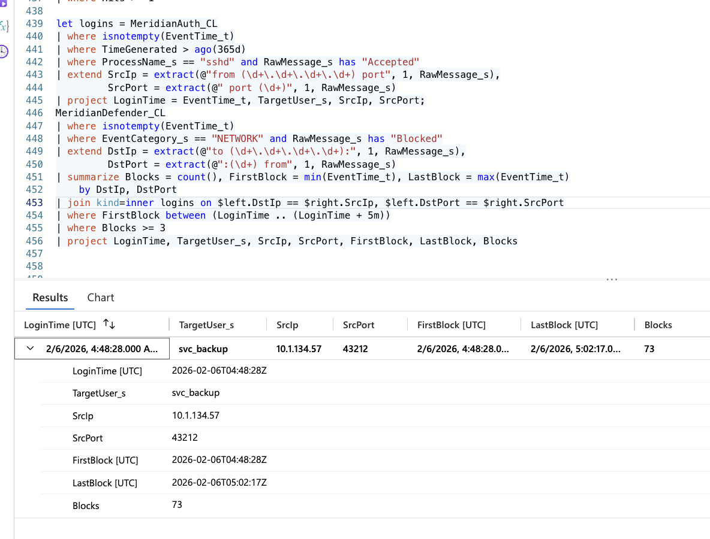

*Figure 14.1: D6 run against the hunt data. One row: the 04:48:28 svc_backup session on port 43212 matched to 73 blocks.*

**Status:** Proposed; validated against Hunt 25.

### D7: Defence stack removal of a telemetry service

**ATT&CK:** No adversary technique: defender misconfiguration. Related to T1562.001 Impair Defenses if an attacker triggers it

**Data source:** MeridianDefender_CL

```kql
let protected_services = dynamic(["sysmon.service", "auditd.service", "rsyslog.service",
"osquery.service", "amazon-ssm-agent.service"]);
MeridianDefender_CL
| where TimeGenerated > ago(365d)
| where isnotempty(EventTime_t)
| where EventCategory_s == "SWEEP"
| where RawMessage_s has "Removed service"
| extend RemovedService = trim(@"\s", extract(@"Removed service: (.+)", 1, RawMessage_s))
| where RemovedService in (protected_services)
| project EventTime_t, RemovedService, RawMessage_s
```

**Logic:** Alerts on any (1 or more) sweep removal of a monitoring or security service.

**FP assessment:** Fires if a protected service is genuinely decommissioned; maintain the list with the monitoring stack. The response is to fix the baseline, not to open an intrusion case, unless attacker activity precedes it.

**Expected on Hunt 25 data:** Should return sysmon.service at 03:08:20.

**Status:** Proposed.

### D8: Patient data export from an address outside the host subnet

**ATT&CK:** T1213 Data from Information Repositories

**Data source:** MeridianDefender_CL

```kql
MeridianDefender_CL
| where TimeGenerated > ago(365d)
| where isnotempty(EventTime_t)
| where EventCategory_s == "WEB"
| where RawMessage_s has "Patient data export"
| extend SourceIp = extract(@"from (\d+\.\d+\.\d+\.\d+)", 1, RawMessage_s)
| where isnotempty(SourceIp) and not(SourceIp startswith "10.1.15.")
| project EventTime_t, SourceIp, RawMessage_s
```

**Logic:** Alerts on any (1 or more) patient data export triggered from outside the host subnet.

**FP assessment:** Legitimate remote staff and API integrations will fire; allowlist their addresses. Pair with a row-count threshold once export volume is logged (G7).

**Expected on Hunt 25 data:** Should return the 03:56:28 export from 10.1.134.57.

**Status:** Proposed.

### D9: Configuration tampering reverted by the sweep

**ATT&CK:** T1565.001 Stored Data Manipulation

**Data source:** MeridianDefender_CL

```kql
MeridianDefender_CL
| where TimeGenerated > ago(365d)
| where isnotempty(EventTime_t)
| where EventCategory_s == "SWEEP"
| where RawMessage_s has "tampered"
| extend File = extract(@"^(\S+) tampered", 1, RawMessage_s)
| project EventTime_t, File, RawMessage_s
```

**Logic:** Alerts on any (1 or more) sweep revert of a tampered file, covering every monitored file rather than backup.conf alone.

**FP assessment:** Changes made through change management before the baseline is updated will fire; suppress during approved change windows.

**Expected on Hunt 25 data:** Should return backup.conf at 05:05:02.

**Status:** Proposed.

### D10: Two root-access methods failing on one host within an hour

**ATT&CK:** T1548.003 Sudo and Sudo Caching; T1110.001 Password Guessing

**Data source:** MeridianAuth_CL

```kql
MeridianAuth_CL
| where TimeGenerated > ago(365d)
| where isnotempty(EventTime_t)
| where (ProcessName_s == "sudo" and RawMessage_s has "command not allowed")
or (ProcessName_s == "sshd" and RawMessage_s has "Failed password for root")
| extend Method = iff(ProcessName_s == "sudo", "sudo_denied", "root_ssh_failed")
| summarize Methods = dcount(Method), Failures = count(),
FirstFail = min(EventTime_t), LastFail = max(EventTime_t), Detail = make_set(RawMessage_s, 10)
by bin(EventTime_t, 1h)
| where Methods >= 2
```

**Logic:** Alerts when both a sudo denial and a failed root SSH password occur within the same hour on the host. Grouping by time rather than by TargetUser_s is deliberate: the sudo denial is logged against svc_backup and the SSH failures against root, so a per-user grouping can never see both methods together. In a multi-host workspace, add the host column to the by clause.

**FP assessment:** Internet-facing hosts see constant root password guessing, which alone cannot fire this rule; it needs a local sudo denial too. A fixed 1-hour bin can split a pair across a boundary; a rolling window via a self-join removes that.

**Expected on Hunt 25 data:** Should return the 04:00 to 05:00 bin: 1 sudo denial (04:15:07) and 6 failed root passwords.

**Status:** Proposed.

### D11: Memory acquisition tool execution

**ATT&CK:** No adversary technique: IR awareness alert

**Data source:** MeridianAudit_CL

```kql
MeridianAudit_CL
| where TimeGenerated > ago(365d)
| where isnotempty(EventTime_t)
| where Types_s has "EXECVE"
| where Argv_s has_any ("avml", "LiME", "linpmem", "memdump", "fmem")
| project EventTime_t, comm_s, exe_s, Argv_s, auid_s, euid_s
```

**Logic:** Fires on any (1 or more) execution of a known memory acquisition tool. Informational severity.

**FP assessment:** Fires during legitimate forensics and scheduled captures. With no open incident, an unexpected capture may be credential theft or unauthorised forensics, so route to the SOC lead rather than suppress.

**Expected on Hunt 25 data:** Should return avml at 05:27:48 and 05:28:24.

**Status:** Proposed.

### D12: One-second SSH session from a non-baseline IP

**ATT&CK:** T1078.003 Valid Accounts: Local Accounts. Candidate T1105 Ingress Tool Transfer if a file copy is confirmed

**Data source:** MeridianAuth_CL

```kql
let baseline_ips = dynamic(["127.0.0.1", "10.1.15.67"]);
MeridianAuth_CL
| where TimeGenerated > ago(365d)
| where isnotempty(EventTime_t)
| where ProcessName_s == "sshd"
| extend Ip = extract(@"(\d+\.\d+\.\d+\.\d+) port (\d+)", 1, RawMessage_s),
Port = extract(@"(\d+\.\d+\.\d+\.\d+) port (\d+)", 2, RawMessage_s)
| where isnotempty(Port) and Ip !in (baseline_ips)
| summarize Start = min(EventTime_t), End = max(EventTime_t),
Accepted = countif(RawMessage_s has "Accepted"),
Closed = countif(RawMessage_s has_any ("Disconnected from", "Received disconnect")),
Users = make_set(TargetUser_s) by Ip, Port
| where Accepted >= 1 and Closed >= 1
| extend DurationSec = datetime_diff('second', End, Start)
| where DurationSec <= 5
```

**Logic:** Alerts on any accepted SSH session from a non-baseline IP that opens and closes within 5 seconds, the pattern of a single remote command or scp rather than an interactive login.

**FP assessment:** Automation (Ansible, backup pulls, monitoring checks) produces short sessions; allowlist their source IPs and accounts. The rule requires an explicit disconnect line, so sessions that are still open, or whose close is not logged, cannot produce a false zero duration.

**Expected on Hunt 25 data:** Should return 10.1.134.57 port 54886 (04:47:44, 0 seconds). Other attacker sessions appear only if their disconnect falls within 5 seconds of the login.

**Status:** Proposed.

## 15 Handover to IR

**Immediate actions, in priority order:**

1.  **Stop health_check and lock svc_backup.** Kill PID 267155 and confirm no other process runs with real UID 1001 and effective UID 0. Preserve /opt/meridian/scripts/health_check (still on disk, F6) for analysis, then remove it. Lock svc_backup and confirm no svc_backup SSH sessions remain open from 10.1.134.57.

2.  **Do not treat the network block as containment.** The 73 blocks cut the return path of the attacker's SSH session (F7). They give no assurance about health_check, whose network behaviour is unknown.

3.  **Rotate every credential in database.conf.** The file was read through the LFI at 04:08:34 (1,231 bytes). Assume the svc_backup password and all database connection strings are compromised.

4.  **Close the initial access vector.** Restrict the config_viewer.php file parameter to an allowlist or remove the endpoint (F2). Find how the attacker authenticated to the portal before the credential theft (L2) and close that path too.

5.  **Start regulatory review as a possible breach.** The defense stack recorded a patient data (PHI) export from the attacker's address at 03:56:28. No other log corroborates it (F8), but the attacker held portal access, so treat it as a possible breach until application export logs or the on-disk MySQL log rule it out. HIPAA breach assessment may apply.

6.  **Analyse the memory image.** /tmp/evidence/memory.lime (05:27:48) holds health_check (PID 267155). Extract the binary for reverse engineering and look for the 04:47:44 and 04:48:28 session artifacts (L1, L3).

7.  **Restore visibility.** Reinstall sysmon.service and add it to the defense stack baseline before declaring the host monitored (G1).

**Evidence preservation:** Hold the avml image and all Meridian Sentinel tables under legal hold pending regulatory review. Do not rotate logs or rebuild the host until the memory image is analysed and the export scope is determined.

| **Field**               | **Value**                                                                                                                                                                                                                                                   |
|-------------------------|-------------------------------------------------------------------------------------------------------------------------------------------------------------------------------------------------------------------------------------------------------------|
| Compromise confirmed    | Yes                                                                                                                                                                                                                                                         |
| Handed to               | PacificWatch SOC Incident Response team                                                                                                                                                                                                                     |
| Time of handover (UTC)  | 2026-10-03 (report submission)                                                                                                                                                                                                                              |
| Immediate risks flagged | health_check (PID 267155) running with effective root; svc_backup credential compromised and account usable; recorded PHI export, uncorroborated and of unknown scope; config_viewer.php still exploitable; portal credential source unknown; Sysmon absent |

## 16 Next-Hunt Leads

| **ID** | **Lead**                                          | **Why it is worth hunting**                                                                                                                                                          | **Data needed**                                                                                                                   |
|--------|---------------------------------------------------|--------------------------------------------------------------------------------------------------------------------------------------------------------------------------------------|-----------------------------------------------------------------------------------------------------------------------------------|
| L1     | health_check binary analysis                      | The binary exists only in memory. Its capabilities, any C2 configuration and its launch method are unknown (F6)                                                                      | /tmp/evidence/memory.lime; volatility3 or equivalent                                                                              |
| L2     | Portal credential source                          | The attacker held a portal session at 03:54:09, 14 minutes before the credential file was read. SQL injection on the login, a default credential, or reuse are all open              | Application authentication logs; POST bodies if retained; MySQL general log from the host disk (Sentinel copy ends 03:20:01)      |
| L3     | Content of the 04:47:44 and 04:48:28 SSH sessions | A one-second session fits a file copy; the blocked session may still have run commands. Either could explain health_check                                                            | Memory image; svc_backup shell history; auditd syscall logging if enabled later                                                   |
| L4     | Confirm or rule out the export                    | The 03:56:28 Defender export event has no matching web request and no MySQL coverage (F8). Confirming it decides the breach notification question                                    | Application export logs; on-disk MySQL general log; defense stack WEB detection logic and its input source                        |
| L5     | health_check launch                               | It was running by 04:51 with no exec record; the launch path (the 04:47:44 one-second session, the blocked 04:48:28 session, or another route) is unknown                            | MeridianAudit_CL execve coverage for /opt/meridian/scripts; memory image process tree; svc_backup shell history                   |
| L6     | Untested negatives                                | Lateral movement, local account creation and destructive commands were not queried                                                                                                   | MeridianAuth_CL and MeridianSyslog_CL for useradd/adduser; MeridianAudit_CL for rm, shred, truncate; outbound SSH from 10.1.15.67 |
| L7     | Credential reuse across the estate                | The svc_backup password sat in plaintext in database.conf and may be reused elsewhere                                                                                                | Credential audit across services; secrets-manager migration plan                                                                  |
| L9     | Backup job and backup.conf                        | backup.sh was failing MySQL root logins every 10 minutes before the attack (7.14), and the attacker later tampered with backup.conf (F9). Whether the two connect is not established | backup.sh and backup.conf contents; MySQL credentials used by the backup job                                                      |
| L8     | Defence stack logic review                        | The stack removed Sysmon, mislabelled an SSH session as exfil, stayed silent between sweeps and left a flagged process running                                                       | Defence stack configuration, baseline definition, sweep and classifier logic                                                      |

## 17 Appendix A: Full Queries

Every query applies isnotempty(EventTime_t). Queries are scoped to the hunt window (2026-02-06 02:42 to 05:30 UTC) unless a narrower window is shown.

### A1: Attacker recon tool breakdown (7.1)

```kql
MeridianAccess_CL
| where isnotempty(EventTime_t)
| where EventTime_t between (datetime(2026-02-06 02:42) .. datetime(2026-02-06 05:30))
| where ClientIp_s == "10.1.134.57"
| summarize FirstSeen=min(EventTime_t), Requests=count() by UserAgent_s
| order by FirstSeen asc
```

### A2: Pre-scan curl requests (7.2)

```kql
MeridianAccess_CL
| where isnotempty(EventTime_t)
| where EventTime_t between (datetime(2026-02-06 02:42) .. datetime(2026-02-06 05:30))
| where ClientIp_s == "10.1.134.57"
| where EventTime_t < datetime(2026-02-06 03:55:00)
| where UserAgent_s == "curl/8.18.0"
| project EventTime_t, HttpMethod_s, RequestUri_s, StatusCode_s
| sort by EventTime_t asc
```

### A3: config_viewer.php requests with response size (7.3)

```kql
MeridianAccess_CL
| where isnotempty(EventTime_t)
| where EventTime_t between (datetime(2026-02-06 02:42) .. datetime(2026-02-06 05:30))
| where ClientIp_s == "10.1.134.57"
| where RequestUri_s contains "config_viewer"
| project EventTime_t, HttpMethod_s, RequestUri_s, StatusCode_s, ResponseSize_s, UserAgent_s
| sort by EventTime_t asc
```

### A4: SSH login after credential theft (7.4)

```kql
MeridianAuth_CL
| where isnotempty(EventTime_t)
| where EventTime_t between (datetime(2026-02-06 04:08) .. datetime(2026-02-06 04:15))
| where ProcessName_s == "sshd"
| where RawMessage_s has "Accepted"
| project EventTime_t, TargetUser_s, SourceIP, RawMessage_s
| sort by EventTime_t asc
```

### A5: Failed escalation attempts (7.5)

```kql
MeridianAuth_CL
| where isnotempty(EventTime_t)
| where EventTime_t between (datetime(2026-02-06 04:00) .. datetime(2026-02-06 05:00))
| where RawMessage_s has_any ("failed", "FAILED", "incorrect", "not allowed", "denied")
| project EventTime_t, ProcessName_s, TargetUser_s, RawMessage_s
| sort by EventTime_t asc
```

### A6: Effective-root executions by non-root users (7.6)

```kql
MeridianAudit_CL
| where isnotempty(EventTime_t)
| where EventTime_t between (datetime(2026-02-06 04:15) .. datetime(2026-02-06 05:00))
| where auid_s != "0" and euid_s == "0"
| project EventTime_t, comm_s, exe_s, Argv_s, auid_s, euid_s
| sort by EventTime_t asc
```

### A7: Second backdoor process snapshot (7.7)

```kql
MeridianSnapshot_CL
| where isnotempty(EventTime_t)
| where isnotempty(ProcBeaconExeLink_s)
| project ProcBeaconName_s, ProcBeaconExeLink_s, ProcBeaconUid_s, ProcBeaconPPid_s
```

### A8: Defender events after the SUID shell, including NETWORK blocks (7.8)

```kql
MeridianDefender_CL
| where isnotempty(EventTime_t)
| where EventTime_t between (datetime(2026-02-06 04:40) .. datetime(2026-02-06 05:30))
| project EventTime_t, EventCategory_s, RawMessage_s
| sort by EventTime_t asc
```

### A9: Kernel NETMON_EXFIL port pairs (7.8)

```kql
MeridianSyslog_CL
| where isnotempty(EventTime_t)
| where EventTime_t between (datetime(2026-02-06 02:42) .. datetime(2026-02-06 05:30))
| where RawMessage_s has "NETMON_EXFIL"
| extend SPT = extract(@"SPT=(\d+)", 1, RawMessage_s), DPT = extract(@"DPT=(\d+)", 1, RawMessage_s)
| project EventTime_t, SPT, DPT, RawMessage_s
| sort by EventTime_t asc
```

### A10: Patient data export (7.9)

```kql
MeridianDefender_CL
| where isnotempty(EventTime_t)
| where EventTime_t between (datetime(2026-02-06 02:42) .. datetime(2026-02-06 05:30))
| where EventCategory_s == "WEB"
| where RawMessage_s has "export"
| project EventTime_t, RawMessage_s
```

### A11: backup.conf tampering (7.10)

```kql
MeridianDefender_CL
| where isnotempty(EventTime_t)
| where EventTime_t between (datetime(2026-02-06 05:04) .. datetime(2026-02-06 05:06))
| where EventCategory_s == "SWEEP"
| where RawMessage_s has "tampered"
| project EventTime_t, RawMessage_s
```

### A12: Bootstrap noise (7.11)

```kql
MeridianDefender_CL
| where isnotempty(EventTime_t)
| where EventTime_t between (datetime(2026-02-06 02:42) .. datetime(2026-02-06 03:47))
| project EventTime_t, EventCategory_s, RawMessage_s
| sort by EventTime_t asc
```

### A13: Sysmon removal (7.12)

```kql
MeridianDefender_CL
| where isnotempty(EventTime_t)
| where EventTime_t between (datetime(2026-02-06 02:42) .. datetime(2026-02-06 05:30))
| where EventCategory_s == "SWEEP"
| where RawMessage_s has "Removed service"
| where EventTime_t < datetime(2026-02-06 03:10:00)
| project EventTime_t, RawMessage_s
```

### A14: avml forensic capture (7.13)

```kql
MeridianAudit_CL
| where isnotempty(EventTime_t)
| where EventTime_t between (datetime(2026-02-06 05:25) .. datetime(2026-02-06 05:30))
| where Types_s has "EXECVE"
| where Argv_s has "avml" or comm_s has "avml"
| project EventTime_t, Argv_s, exe_s, auid_s, euid_s
```

### A15: sudo records, baseline and denial (7.4, 7.5)

```kql
MeridianAuth_CL
| where isnotempty(EventTime_t)
| where EventTime_t between (datetime(2026-02-06) .. datetime(2026-02-07))
| where ProcessName_s in ("sudo", "su")
| project EventTime_t, ProcessName_s, TargetUser_s, RawMessage_s
| sort by EventTime_t asc
```

### A16: Legitimate cron activity (7.7 baseline)

```kql
MeridianSyslog_CL
| where isnotempty(EventTime_t)
| where EventTime_t between (datetime(2026-02-06 04:40) .. datetime(2026-02-06 05:00))
| where RawMessage_s has_any ("cp ", "chmod", "bash", "suid")
| project EventTime_t, ProcessName_s, RawMessage_s
| sort by EventTime_t asc
```

### A17: MeridianNetwork_CL schema probe (dead end)

```kql
MeridianNetwork_CL
| where isnotempty(EventTime_t)
| take 10
```

### A18: Attacker SSH activity after the SUID shell (7.5, 7.8)

```kql
MeridianAuth_CL
| where isnotempty(EventTime_t)
| where EventTime_t between (datetime(2026-02-06 04:40) .. datetime(2026-02-06 05:05))
| where RawMessage_s has "10.1.134.57"
| project EventTime_t, ProcessName_s, TargetUser_s, RawMessage_s
| sort by EventTime_t asc
```

### A19: Defender DETECTION, SSH and AUTH between sweeps (7.4, 7.8, 7.11)

```kql
MeridianDefender_CL
| where isnotempty(EventTime_t)
| where EventTime_t between (datetime(2026-02-06 03:09) .. datetime(2026-02-06 05:05))
| where EventCategory_s in ("DETECTION", "SSH", "AUTH")
| project EventTime_t, EventCategory_s, RawMessage_s
| sort by EventTime_t asc
```

### A20: Second-source test for the export (7.9)

```kql
MeridianAccess_CL
| where TimeGenerated > ago(365d)
| where isnotempty(EventTime_t)
| where EventTime_t between (datetime(2026-02-06 03:56:20) .. datetime(2026-02-06 03:56:35))
| where ClientIp_s == "10.1.134.57"
| where RequestUri_s has_any ("export", "patient", "download")
| project EventTime_t, UserAgent_s, HttpMethod_s, RequestUri_s, StatusCode_s, ResponseSize_s
| sort by EventTime_t asc
```

### A21: NETWORK block count (7.8)

```kql
MeridianDefender_CL
| where isnotempty(EventTime_t)
| where EventTime_t between (datetime(2026-02-06 04:48) .. datetime(2026-02-06 05:03))
| where EventCategory_s == "NETWORK"
| where RawMessage_s has "Blocked"
| summarize TotalBlocks = count(), FirstBlock = min(EventTime_t), LastBlock = max(EventTime_t)
```

### A22: MySQL coverage probe (7.14)

```kql
MeridianMySQL_CL
| where TimeGenerated > ago(365d)
| summarize Rows = count(),
WithEventTime = countif(isnotempty(EventTime_t)),
FirstIngest = min(TimeGenerated), LastIngest = max(TimeGenerated)
```

### A23: MySQL general log, all rows (7.14)

```kql
MeridianMySQL_CL
| where TimeGenerated > ago(365d)
| where isnotempty(EventTime_t)
| sort by EventTime_t asc
```

### A24: NETWORK blocks by destination (7.8)

```kql
MeridianDefender_CL
| where isnotempty(EventTime_t)
| where EventTime_t between (datetime(2026-02-06 04:48) .. datetime(2026-02-06 05:03))
| where EventCategory_s == "NETWORK" and RawMessage_s has "Blocked"
| extend Dest = extract(@"to (\S+) from", 1, RawMessage_s)
| summarize Blocks = count() by Dest
```

### A25: Non-gobuster attacker requests in the export window (7.9)

```kql
MeridianAccess_CL
| where TimeGenerated > ago(365d)
| where isnotempty(EventTime_t)
| where EventTime_t between (datetime(2026-02-06 03:56:20) .. datetime(2026-02-06 03:56:35))
| where ClientIp_s == "10.1.134.57"
| where UserAgent_s !startswith "gobuster"
| project EventTime_t, UserAgent_s, HttpMethod_s, RequestUri_s, StatusCode_s, ResponseSize_s
```

### A26: Attacker HTTP 200 responses at the export second (7.9)

```kql
MeridianAccess_CL
| where TimeGenerated > ago(365d)
| where isnotempty(EventTime_t)
| where EventTime_t between (datetime(2026-02-06 03:56:27) .. datetime(2026-02-06 03:56:29))
| where ClientIp_s == "10.1.134.57" and StatusCode_s == "200"
| project EventTime_t, RequestUri_s, StatusCode_s, ResponseSize_s
```

### A27: Any attacker request in the export window (7.9)

```kql
MeridianAccess_CL
| where TimeGenerated > ago(365d)
| where isnotempty(EventTime_t)
| where EventTime_t between (datetime(2026-02-06 03:56:20) .. datetime(2026-02-06 03:56:35))
| where ClientIp_s == "10.1.134.57"
| summarize Requests = count(), Uris = dcount(RequestUri_s) by StatusCode_s, UserAgent_s
```

### A28: All clients and user-agents, 03:55 to 04:08 (7.1, 7.9)

```kql
MeridianAccess_CL
| where TimeGenerated > ago(365d)
| where isnotempty(EventTime_t)
| where EventTime_t between (datetime(2026-02-06 03:55) .. datetime(2026-02-06 04:08))
| summarize Requests = count(), First = min(EventTime_t), Last = max(EventTime_t) by ClientIp_s, UserAgent_s
| sort by First asc
```

### A29: Attacker requests after the scan, 03:55:09 to 04:08:00 (7.2, 7.9)

```kql
MeridianAccess_CL
| where TimeGenerated > ago(365d)
| where isnotempty(EventTime_t)
| where EventTime_t between (datetime(2026-02-06 03:55:09) .. datetime(2026-02-06 04:08:00))
| where ClientIp_s == "10.1.134.57"
| project EventTime_t, HttpMethod_s, RequestUri_s, StatusCode_s, ResponseSize_s
| sort by EventTime_t asc
```

**References:** MITRE ATT&CK Enterprise matrix (attack.mitre.org); PEAK threat hunting framework (Splunk SURGe); TaHiTI threat hunting methodology.

PacificWatch SOC. Hunt 25 MERIDIAN, version 1.5. Analyst: Jenna Frank. 2026-10-03.  
  
AI Disclosure: AI tools were used to assist with proofreading, formatting, and minor editorial refinement. All analysis, interpretations, and conclusions are the author’s own.
